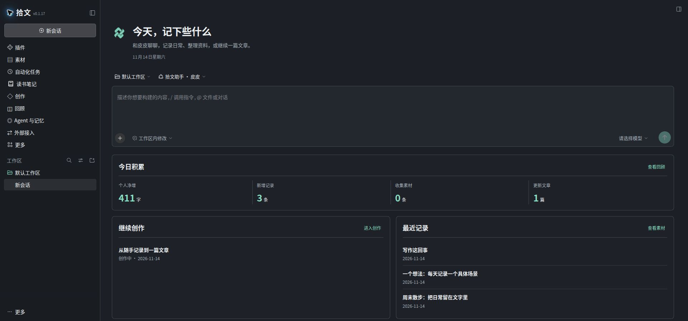
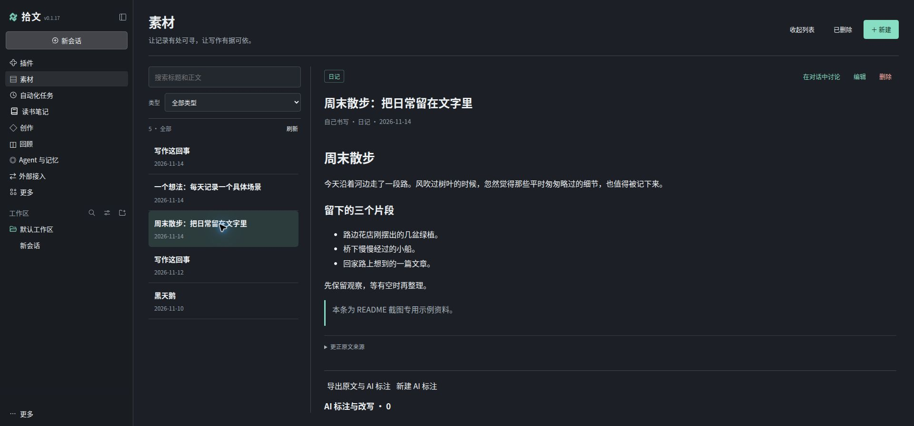
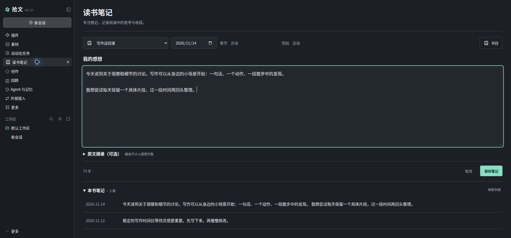
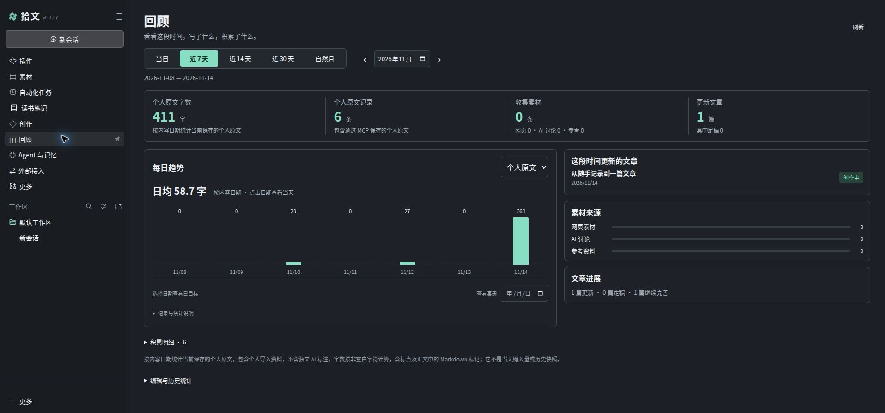
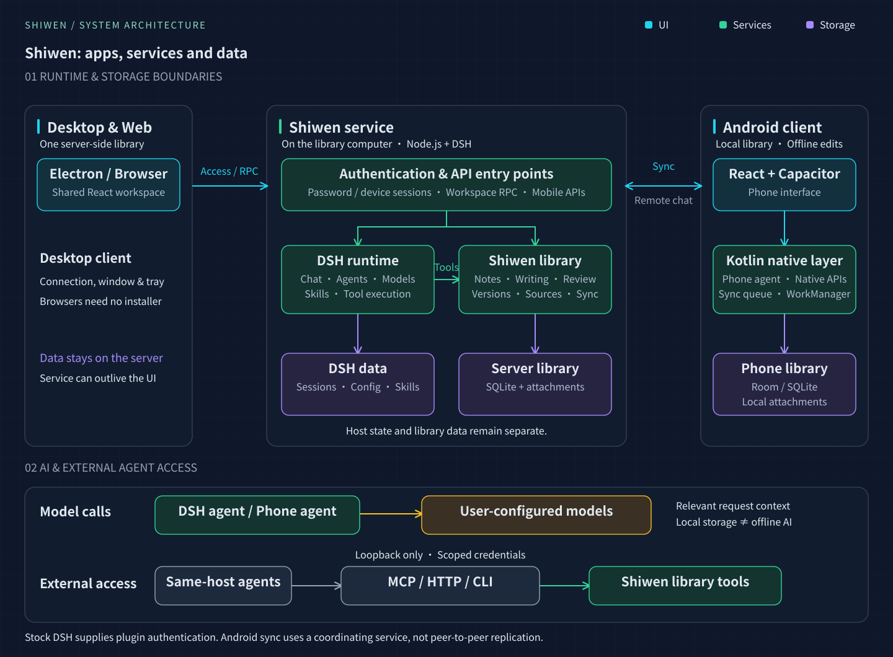

<p align="center"></p>

# Shiwen DSH

**Keep everyday thoughts and useful material, and gradually make something of them.**

Shiwen is a personal AI workspace built on [DeepSeek Harness (DSH)](https://github.com/deepseek-ai/deepseek-harness). Write a journal, capture an idea, collect something worth reading, or discuss it with an agent. Return to those records to reflect, develop your thinking and write articles. The library is stored on your own computer.

[中文](README.md) | English

[Why Shiwen](#why-shiwen) · [What it does](#what-it-does) · [Screenshots](#screenshots) · [Architecture](#architecture) · [Getting started](#getting-started) · [Data and privacy](#data-and-privacy) · [Contributing](#contributing)

Downloads: **[Android 0.1.58](https://github.com/wyf929597870/shiwen-dsh/releases/tag/android-v0.1.58)**, **[Linux 0.1.58](https://github.com/wyf929597870/shiwen-dsh/releases/tag/v0.1.58)**, **[Windows 0.1.9 Preview](https://github.com/wyf929597870/shiwen-dsh/releases/tag/windows-v0.1.9)** and [DSH plugin 0.2.0-dev.7](https://github.com/wyf929597870/shiwen-dsh/releases/tag/v0.2.0-dev.7). Licensed under [MIT](LICENSE). Exploration sync with Android requires version 0.1.57 or later of the computer service. An on-device Android upgrade check is pending for this release. Windows installation and service lifecycle were checked for the previous version; full GUI validation of the new version remains outstanding. No project macOS installer is provided.

Browse Records, Reading, Collections and Writing on desktop and Android. Open a source from global search or generate a linked article outline from related passages. Before upgrading the computer, quit the client and stop the old service. Restart the service after installation. [Changelog](CHANGELOG.md)

## Screenshots

Captured on 2026-11-14 using the locally installed **Shiwen 0.1.17** package. These are browser captures of its complete workspace, including the actual DSH navigation and Shiwen pages, connected to the real service and a separate temporary library. All records are fictional examples created for these screenshots. They show the desktop / Web workspace, not an Electron window or Android device. [Sources and reproduction steps](docs/screenshots/README.md)

### Workspace home

Start a conversation, review today's activity, revisit recent records and continue an article.



### Materials and records

Search and filter materials, read content alongside the list, and edit, discuss or annotate a record.



### Reading notes

Organize reflections by book; each highlight becomes its own note with optional chapter, page and the quoted text. Reflections and quotations are counted separately.



### Review and progress

Review personal writing, collected material and article progress over time, with daily trends and goals.



## Why Shiwen

Shiwen began with a personal wish: a more comfortable place to keep my notes.

Many note-taking and knowledge-management tools offer a lot of functionality, but learning and maintaining them takes effort. I wanted recording things to feel simpler: write down a thought, save an interesting article, or talk a question through with AI, without first having to design an entire system of categories, templates and workflows.

There was another reason. Some things feel better kept on my own computer. Journals, unfinished thoughts and notes from work can be deeply personal. I wanted control over where they live, without having to host the whole library in the cloud just to organize it.

That became Shiwen. Built on DSH, it brings conversation, note-taking, organizing and writing into one workspace. I want the agent to help capture ideas, find earlier records, make sense of collected material and, when useful, develop those fragments into an article.

The name 拾文 reflects that wish: gathering the fragments of daily life worth keeping, and letting them become something I can return to and build on.

> Shiwen stores its library locally. When you use a cloud AI model, conversations and relevant material included in requests are still sent to the configured provider. Local storage does not mean all AI processing happens offline.

## What it does

| What you want to do | How Shiwen helps |
| --- | --- |
| Capture a moment | Save journals, ideas, freewriting and references, with Markdown editing and a readable preview |
| Capture a reading highlight | Save each highlight under its book, optionally add a reflection, and review your excerpts and writing separately |
| Think with AI | Use native DSH conversations, discuss a selected record and save AI responses as material |
| Organize your library | Filter by type and search text; ask the agent to update type, authorship, dates or content, and delete or restore records |
| Look back | Review a day, the last 7/14/30 days or a calendar month; ask the agent to search and read records from that period |
| Develop an article | Create an article, link its source material and review pre-publication prompts |
| Collect ideas around a topic | Gather passages from journals, freewriting and reading notes into themes, retain source snapshots, and find articles linked to a material |
| Follow relationships | Browse themes, article sources and manual links without changing the current center; explicitly pivot and navigate back or forward |
| Connect another agent | Save, query and manage material through MCP, HTTP, CLI and a companion Skill |

Search for exact text on the computer, or download the optional model to search by meaning on the computer hosting the library. Expand related passages on the idea canvas and select cards to create an article outline. Android supports offline text search, expandable related passages, returning to your reading position and outline creation. Semantic search on Android requires a connection to the computer for that library.

Record lists use descending content dates, then creation times within each day, with unknown dates last. Personal writing, external sources and AI content have separate attribution. An agent saving your words does not automatically make them AI-authored.

The built-in Pipi persona is editable. You can change its identity and communication style, and proposed long-term memories require confirmation before use.

## Ways to use it

You can write directly in the material library or, after configuring a model, ask the agent for help. For example:

> “Save what I just said verbatim as today's journal entry, attributed to me.”

> “Find last month's journals and ideas, read them, and help me look back on what happened. Tell me which records you used.”

> “Find existing material for this topic. Discuss an outline with me first, then help turn it into a draft.”

These are example requests; results depend on your material, model and tool configuration. Pre-publication checks are advisory. Facts, citations and private information still need human review.

## Architecture

Shiwen combines a **DSH host, business plugins, an Electron desktop client and an Android client**. Desktop and browser clients access the same server-side library. Android maintains its own complete local library and exchanges changes with a coordinating service.



The upper panel separates clients, the service and storage by runtime location. The lower panel shows model calls and external Agent access. Cyan denotes UI, green services and purple storage.

[SVG](diagram/system-architecture/architecture.en.svg) · [PNG @2x](diagram/system-architecture/architecture.en@2x.png)

### Modules and responsibilities

| Module / directory | Responsibility |
| --- | --- |
| `desktop/` | Electron client, connection preferences, tray and service lifecycle interactions |
| `scripts/server*.mjs`, `integration/` | Standalone service lifecycle, password and device authentication |
| `plugins/workbench/` | Materials, reading notes, writing, review, settings and external-access UI |
| `plugins/library/` | SQLite library, versions, provenance, attachments, statistics, import/export and sync storage |
| `plugins/agent-tools/`, `plugins/external/` | Host Agent tools and external MCP / HTTP / CLI interfaces |
| `plugins/mobile/` | Adapters for mobile sync, persona, remote sessions and management |
| `plugins/personal-context/`, `plugins/theme/` | Optional assistant persona, long-term memory context and theme |
| `android/web/`, `android/bridge/` | Android React UI and Capacitor bridge contracts |
| `android/native/` | Kotlin / Room storage, phone agent, background sync, backup and system file integration |
| `contracts/`, `tests/` | Cross-platform protocols, fixtures and automated checks |
| `bundle/`, `skills/`, `patches/` | DSH bundle, Agent instructions and pinned upstream patches |

### Data flow

- **Desktop / Web:** the UI calls Shiwen through DSH RPC. Records and attachments live on the server computer; its standalone service can remain running after the client exits.
- **Android:** edits commit locally before entering the sync queue. The selected service coordinates changes; conflicts preserve both sides for resolution. Android is a separate local library, not a browser cache or arbitrary peer-to-peer sync.
- **AI and external agents:** DSH runs host conversations and models; phone AI uses separately configured credentials. Library operations go through the corresponding tools. External access is credential-scoped and listens only on the server computer's loopback interface.
- **Standalone plugin:** a stock DSH installation supplies authentication and profile isolation. The password layer shown above belongs to Shiwen's standalone service, not the plugin tarball.

Details: [Standalone service](docs/server.md) · [Web plugin](docs/web-plugin.md) · [Android architecture](docs/android/architecture.md) · [External access](docs/external-access.en.md) · [Development](docs/development.md)

## Getting started

Under **Shiwen menu → Connection and desktop settings**, choose whether closing the window hides it to the tray or quits. Explicit Quit retains the local-service keep, stop or cancel prompt.


### Web plugin preview

With **DSH 0.2.2-alpha.3 / Node.js >=24.9**, download the **[prebuilt plugin (.tgz)](https://github.com/wyf929597870/shiwen-dsh/releases/download/v0.2.0-dev.7/dsh-shiwen-0.2.0-dev.7.tgz)** without cloning this repository. See the [release notes](https://github.com/wyf929597870/shiwen-dsh/releases/tag/v0.2.0-dev.7) for installation, checksums and limitations.

Run from this repository, without Electron or an upstream checkout:

```bash
npm ci
npm run start:web -- --no-open
```

Open the login URL printed by DSH. This uses a dedicated `shiwen-web` profile. Alternatively, run `npm run package:plugin` and install the prebuilt tarball into stock DSH Web. DSH supplies conversations and models; the plugin adds the library, organization, review and writing features.

[Web setup, storage and validation](docs/web-plugin.md) · [Bundle configuration](bundle/README.md)

### Desktop client and standalone service

The Linux package includes the client, standalone service and Node runtime, with no separate Node installation required. Data stays on **the computer running the service**. Local mode uses that computer's library; remote mode accesses another computer's library without copying or merging it.

| Connection | Startup and exit behavior |
| --- | --- |
| This computer | Reuse a running service or start it automatically; on exit, choose keep, stop or cancel |
| LAN / another computer | Enter the server address and access password; closing the client does not stop the remote service |

**First use:**

1. Open Shiwen on the computer that stores your library. Select **This computer** and enable LAN access if other computers or phones should connect.
2. Set an access password on the first page, using at least 10 characters. This workspace password is separate from your model provider's API key.
3. On another desktop client, choose **LAN / another computer** and enter the address and password. Computer and phone browsers open the clean URL, such as `http://192.168.1.20:3080/`, and sign in. No token is needed in the address.
4. Choose **Remember this device** for a 30-day credential. Otherwise, login uses a browser session cookie with a server-side maximum lifetime of 12 hours. Desktop connection preferences never store the password.

Under **Settings → Shiwen data → Manage password and devices**, change the password, revoke a device or sign out. **External access** also links to this page. Changing the password requires the current password and signs out other devices. Revocation also closes that device's live connections. Unexpired credentials survive service restarts at the same protocol, address and port. All signed-in devices share this personal workspace; separate user roles are not implemented.

**Local installation or upgrade:** complete the [desktop build prerequisites](docs/development.md#3-桌面构建前置条件--desktop-prerequisites), then build from the repository directory. Before installation, quit the desktop client and stop any running standalone service. Choosing to keep the service running when closing the client is not enough for an upgrade.

```bash
npm run package:linux
# Quit the client and stop the old service before installing
sudo apt install ./release/linux/shiwen-dsh_*_amd64.deb
```

For a service launched from source, use `npm run server:stop` with the same data root. The package also includes management commands that need no system Node; see the [standalone service guide](docs/server.md). Restart the local service after upgrading. To use a prebuilt package, download the v0.1.58 installer below.

### Run only the service and connect from a browser

With Node.js >=24.9, run these commands in the repository on the server computer. First quit any older desktop or service using the same library:

```bash
npm ci
npm run server:prepare
npm run server:start -- --lan
npm run server:url
```

Open the one-time administration link from `server:url` on the server computer to set the first password. The link expires after five minutes, works once, and must not be shared. Use `npm run server:status` to find the clean service address for other devices, which sign in with the password. Without `--lan`, the service accepts local connections only. With multiple interfaces, select an address explicitly using `--host <LAN IP>`.

The service can run without a desktop window. LAN devices must be able to reach each other; a phone cannot use `127.0.0.1` to reach the computer. HTTP is for trusted LANs. See the [service guide](docs/server.md) for HTTPS, lifecycle commands and storage details.

### Published Linux desktop

Download the **[Linux x64 installer (.deb)](https://github.com/wyf929597870/shiwen-dsh/releases/download/v0.1.58/shiwen-dsh_0.1.58_amd64.deb)**. The Windows installer is available below. See the [release notes](https://github.com/wyf929597870/shiwen-dsh/releases/tag/v0.1.58) for checksums and known limitations.

Fully quit Shiwen and stop any running standalone service, then install or upgrade from your download directory:

```bash
sudo apt install ./shiwen-dsh_0.1.58_amd64.deb
```

Open 拾文 from the application menu or run `shiwen-dsh`. The package includes Electron, Node, DSH and Shiwen plugins; no separate Node installation or source checkout is required. Desktop validation currently covers Ubuntu 26.04 x64. Other distributions still need testing.

Start by creating a record in Records. For AI conversations, configure a model and credentials through DSH first. The installer does not include a model-service account or API key.

### Signed Android installer

Download the [Android 0.1.58 APK](https://github.com/wyf929597870/shiwen-dsh/releases/download/android-v0.1.58/shiwen-android-0.1.58.apk), requiring Android 9 or later. Install updates over the existing release to preserve data and settings; do not uninstall an app containing unsynced records. This is a release-signed APK, separate from the `.probe` debug application and its storage.

The phone keeps a complete local library and supports offline editing. Add and name a service node in Settings with its address and password, then sync manually or enable automatic sync when the service is reachable on the LAN. Phone model credentials are configured separately and excluded from library sync. See [release notes](https://github.com/wyf929597870/shiwen-dsh/releases/tag/android-v0.1.58) and the [Android guide](android/README.md).

### Windows x64 preview installer

Download [Windows 0.1.9 Setup](https://github.com/wyf929597870/shiwen-dsh/releases/download/windows-v0.1.9/shiwen-dsh-0.1.9-windows-x64.exe). It includes the desktop client, standalone service, Node and the Microsoft Visual C++ x64 runtime. Installation requires administrator permission. The installer is not code-signed, so Windows may show an unknown-publisher warning.

First installation, upgrade installation, test-library relocation and service start/stop were verified for version 0.1.7 in a Windows 10 VM. Full GUI workflows for 0.1.9 and other Windows versions remain unverified. Quit the client and stop its local service before upgrading. See the [Windows release notes](https://github.com/wyf929597870/shiwen-dsh/releases/tag/windows-v0.1.9).

### Share data between desktop and Web

The desktop client, computer browser and phone browser connect to **one standalone service, library and set of conversations**. Find or copy its address under **External access → Browser access**, then sign in with the access password. No reimport is needed. Keeping the service running when quitting the local client lets browsers continue using it; the server computer must remain awake and reachable.

Change panels or refresh to read another client's saved records, and reopen a record to load its content. Unsaved drafts remain in each window; stale saves are rejected when two clients edit the same record. The Android app has a separate local library and server-coordinated synchronization implementation. This does not automatically make the desktop/Web clients offline replicas or enable peer-to-peer sync. The signed Android APK is available; see its [implementation and validation boundaries](docs/android/delivery-board.md).

In current source, themes, passages and manual links are shared by PC/Web clients connected to the same service and included in full PC library backups. Each passage retains its own identity, source snapshot and location information; edits, deletion or a different source library produce an explicit location status without discarding the snapshot. Linked articles selected the material as a source; this does not prove a quotation exists in their text. Possible matches use local semantic search and are loaded on request; a match becomes a relationship only after confirmation. On Android, Computer topics reads and writes topics on the connected computer for that library. Phone topics are stored in the current phone library. Use a full computer backup to restore computer topics and manual links.

The published v0.1.5 desktop still uses the older flow: copy a full login link from **External access → Browser access**, use it in a browser on the same computer, and keep the desktop running. The plugin installed in stock DSH retains host authentication. The separate `shiwen-web` profile created by `npm run start:web` does not automatically connect to your desktop library. See the [Web plugin guide](docs/web-plugin.md).

### Bring an earlier Shiwen library

Open **Settings → Shiwen data → Import previous library**, enter the path to the old Shiwen database on the server computer and preview it before importing. In published v0.1.5, the entry is still under **Materials**. The destination must be empty. The source is read only, and old messages remain archives rather than being converted into native DSH sessions.

This repository maintains the DSH edition only. The earlier standalone client is no longer updated here.

### Connect an external agent

Open **External access** (under **More** if the sidebar is crowded), create a client credential, select permissions and copy the generated MCP configuration into your agent. Only creation is allowed by default. Permissions can be granted separately and credentials revoked. Keep the library Host or standalone service running. External-agent interfaces listen only on the server computer’s loopback address; enabling LAN Web access does not expose these interfaces to the LAN.

[Integration guide](docs/external-access.en.md) · [中文说明](docs/external-access.md) · [Companion Skill](skills/shiwen-library/SKILL.md)

## Data and privacy

Web plugin data defaults to `$DSH_HOME/shiwen/<profile>/library`, with DSH_HOME defaulting to `~/.dsh`. Data lives on the DSH host; profiles are isolated by default.

The local Linux desktop and standalone service share the data root at `${XDG_DATA_HOME:-~/.local/share}/shiwen-dsh`:

| Directory | Contents |
| --- | --- |
| `library/` | Shiwen records, content and provenance in a local database |
| `dsh/` | DSH sessions, configuration and skills |
| `desktop/` | Desktop connection preferences and client session data |
| `server/` | Service state, logs and password authentication database |
| `workspaces/` | Working files |

When connected remotely, the library stays on the server computer. Passwords are stored as salted scrypt derivations, and the server stores only hashes of device credentials. Keep local administration links and device credentials private.

Markdown content lives in the local library database; each record is not a separate `.md` file. Personal material, sessions and credentials are not bundled. Uninstalling or reinstalling does not automatically erase user data.

Set `SHIWEN_ROOT_DIR` to choose another data directory. Development and installed builds otherwise share the default root, so development tests should use a separate temporary directory.

External data transfer depends on the models and tools you use. Cloud models receive the conversation context and relevant tool results included in requests. External MCP servers or other services receive the arguments sent when calling them. Choose configurations appropriate to your material. Disabling a memory changes subsequent context assembly; earlier conversations and summaries may still contain it.

## Current status

| Status | Scope |
| --- | --- |
| Verified locally | Linux startup, local service start/reuse, library operations/filtering/date order, deletion/restoration, restart persistence, external MCP/HTTP/CLI; password login, device revocation and live-connection shutdown; narrow-screen and bilingual login pages |
| Still needs validation | Installation/upgrades on additional machines, complete Windows GUI workflows and macOS, real-model end-to-end flows and individual provider/external-agent configurations |
| Desktop still to implement | Automatic updates, article export and version-history UI |
| Android released | Full local library, phone agent, multi-node sync, backups and DSH management pages. Earlier releases were tested on a phone for upgrades, saving and LAN sync; other systems and background scenarios remain to be verified. See [delivery status](docs/android/delivery-board.md). |

A standalone bundle can now be built and installed through DSH's CLI, while the Linux desktop shares the same business modules. The bundle is distributed through [GitHub Releases](https://github.com/wyf929597870/shiwen-dsh/releases/tag/v0.2.0-dev.7) and is not published to npm; the `dsh-plugin` topic does not imply official inclusion. See [plugin architecture and publication status](docs/plugin-status.md).

## Contributing

With Node.js >=24.9, npm and Git installed, build and test Shiwen's plugins from the cloned repository:

```bash
npm ci
npm run build
npm test
npm run check:source
```

Tests use temporary material and no paid models. HTTP/MCP tests need loopback networking. These commands do not launch the full desktop application.

Desktop development also needs the pinned DSH upstream, Linux patches and native runtime assets. See [development instructions](docs/development.md) for preparation and acceptance commands. `upstream.lock.json` records the upstream revision and patches; business modules live in `plugins/`.

Questions, bugs and ideas are welcome in [Issues](https://github.com/wyf929597870/shiwen-dsh/issues). Read the [contribution guide](CONTRIBUTING.md) before submitting code.

[Changelog](CHANGELOG.md) · [Tools and Skills guide](docs/extensions.md) · [Development](docs/development.md)

## Acknowledgments and license

Thanks to [DeepSeek Harness](https://github.com/deepseek-ai/deepseek-harness) for the native conversations, session management and agent execution that let Shiwen focus on notes, materials and writing.

Shiwen is an independent community project under the [MIT license](LICENSE). Dependencies retain their own licenses; see [third-party notices](THIRD_PARTY_NOTICES.md).

## Local build outputs

| Platform | Package command | Output directory |
| --- | --- | --- |
| Linux x64 | `npm run package:linux` | `release/linux/` |
| Windows x64 | `npm run package:windows` on Windows x64 | `release/windows/` |
| Android | `npm --prefix android run android:release` with signing configured | `release/android/` |
| DSH plugin | `npm run package:plugin` | `debug/plugin/` for development versions, `release/plugin/` for stable versions |

For an unpacked desktop build, append `-- --dir` to the package command. For Android debug builds, use `npm --prefix android run android:debug`. Each build replaces the previous verified artifacts for its platform and channel after validation. [Packaging conventions](AGENTS.md)
