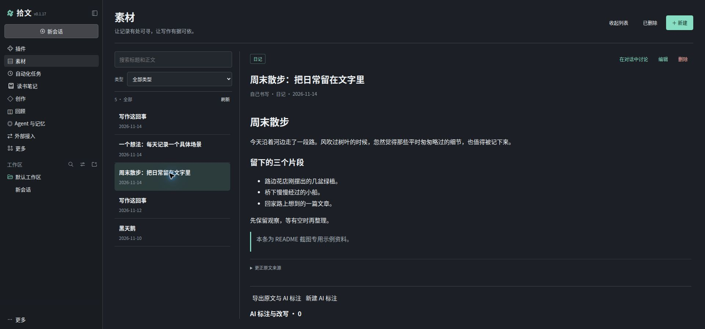

<p align="center"></p>

# 拾文 · Shiwen DSH

拾文是一个开源的个人写作与资料库。你可以在手机上写一篇自由书写，在电脑上把其中一句和读过的书摘放进同一主题，也可以留下一个问题，过几天再回来写自己的回应。原文、AI 批注、探索问题和文章草稿各自保存，可以沿着出处找回它们之间的关系。

[English](README.en.md) · [更新记录](CHANGELOG.md) · [界面截图](docs/screenshots/README.md)

## 安装与升级

| 平台 | 下载 | 使用方式 |
| --- | --- | --- |
| Linux x64 | [0.1.67 · Debian 安装包](https://github.com/wyf929597870/shiwen-dsh/releases/download/v0.1.67/shiwen-dsh_0.1.67_amd64.deb) · [校验文件](https://github.com/wyf929597870/shiwen-dsh/releases/tag/v0.1.67) | 自带桌面客户端、独立服务和 Node 运行环境 |
| Android 9 及以上 | [0.1.67 · 正式签名 APK](https://github.com/wyf929597870/shiwen-dsh/releases/download/android-v0.1.67/shiwen-android-0.1.67.apk) · [校验文件](https://github.com/wyf929597870/shiwen-dsh/releases/tag/android-v0.1.67) | 可在手机独立使用，也可与电脑同步 |
| Windows x64 | [0.1.9 · 桌面预览版](https://github.com/wyf929597870/shiwen-dsh/releases/tag/windows-v0.1.9) | 早期版本，功能以该版发布说明为准 |
| 已有 DSH Web 的用户 | [0.2.0-dev.7 · 插件预览版](https://github.com/wyf929597870/shiwen-dsh/releases/tag/v0.2.0-dev.7) | 使用已有 DSH 宿主的登录和 profile。[插件指南](docs/web-plugin.md) |

Linux 下载后运行 `sudo apt install ./shiwen-dsh_0.1.67_amd64.deb`。升级前退出客户端并停止旧的独立服务，升级后重新启动。Android 直接覆盖安装正式 APK，保留手机资料和未同步的修改。项目目前提供上述安装包，macOS 用户可以用浏览器访问已运行的拾文服务。

## 从一篇自由书写开始

1. 在「记录」新建一篇自由书写。日期决定它在列表和回顾里的位置。AI 给这篇写的批注独立保存，关联当时的原文版本，个人写作统计只计入属于你的文字。
2. 打开这篇记录的「待探索」，可以从整篇或选中的原句提出问题。想看整个资料库的问题，从「记录」列表进「待探索」，安卓也可以从首页进入。新问题先到「原始池」，收下后进入「探索池」。
3. 过几天有了新想法，可以直接写回应，也可以把后来写的一篇记录关联为回应。还可以从回应追问、记下目前的判断、安排一次尝试，再把实际结果记在那次尝试下面。想继续跟进时，可以把问题放到今天或本周的首页。

**问题如何出现在单篇资料里？** 批注里的「待探索」文字要经过整理，或者由外部 Agent 在入库时提交带出处的候选，才会出现在探索池里。已有批注可从「待探索 → 手动整理 → 整理历史批注」提取明确列出的问题；最近新增或修改的资料用「现在整理」。单篇入口按出处筛选，总池供你跨资料浏览。

**发现设置在哪里？** Linux 桌面和安卓都在 **设置 → 待探索**。「每日发现」控制是否定期整理新增或修改的资料，「允许模型分析个人原文」控制整理时能否把个人原文交给配置的模型分析。两项按当前资料库保存。安卓连接电脑资料库时，由电脑服务管理这组设置。

## 读书、查找和创作

| 当你想…… | 可以从这里开始 |
| --- | --- |
| 记下读书时划的一句话 | 在「读书」按书名保存摘录、章节、页码和自己的感想。每条划线可以独立记录，回看时能区分书里的原话和自己的判断。 |
| 找回以前写过的东西 | 全局搜索支持按原文和按意思查找，点命中片段可回到出处。桌面语义搜索可按需下载本地模型；Android 安装包内置中文 BGE 模型，按资料库建立本地索引，可离线搜索已处理的内容。 |
| 把分散的文字整理成文章 | 将原文片段收进主题，或在画布中逐层展开相关资料、选择素材生成大纲。「创作」保存草稿、关联素材和文章状态。 |
| 看看最近积累了什么 | 「回顾」按内容日期统计日记、自由书写与读书等积累，可看趋势和明细。书摘、AI 批注和个人原创分别处理。 |
| 和 AI 讨论一篇资料 | 桌面通过 DeepSeek Harness 提供对话与工具，手机可单独配置模型。可以把讨论中的内容保存为资料，或把 AI 的分析作为原文批注保留。 |



上图使用 0.1.17 的示例资料库，展示记录列表与正文的阅读方式。0.1.67 新增的设置入口见上方「发现设置在哪里」。

## 资料存在哪里

桌面和浏览器读取服务电脑上的同一资料库。Linux 默认数据根目录是 `~/.local/share/shiwen-dsh`（遵循 `XDG_DATA_HOME`），也可以用 `SHIWEN_ROOT_DIR` 指定。Markdown 正文保存在 SQLite，图片等附件另行保存。独立 DSH Web 插件按宿主 profile 存储。

Android 有自己的本地资料库，可以断网写作。需要同步时，在手机「设置 → 服务节点」连接电脑的服务地址，再到「资料库同步」查看状态和处理冲突。手机和电脑上的模型凭据独立配置。使用云端模型时，请求中的对话和相关资料会发送给所选服务商。 [手机使用说明](android/README.md) · [连接指南](docs/node-connectivity.md)

旧版拾文数据库可从桌面「设置 → 拾文资料 → 导入旧版资料」预览后导入空库。文件路径应是运行服务的电脑上的路径。

## 接入其他 Agent

在桌面的「外部接入」为客户端创建凭据、选择权限，将生成的 MCP 配置交给对应的 Agent，并安装配套的 `shiwen-library` skill。支持 MCP、HTTP 和 CLI。接口监听服务电脑的回环地址，提供资料库的服务需要保持运行。

例如，让 Agent 把你的自由书写按本人原文保存，把点评单独存为 AI 批注，再把批注里列出的问题带上这篇记录的出处提交到原始池。保存后可以按记录 ID 读回问题，核对它们是否确实出现在这篇资料下。 [外部接入文档](docs/external-access.md) · [拾文 skill](skills/shiwen-library/SKILL.md)

## 从源码运行

使用 Node.js 24.9 或更高版本。在仓库根目录运行以下命令即可启动 Web 工作台，打开终端给出的地址。它默认使用独立的 `shiwen-web` profile。

```bash
npm ci
npm run start:web -- --no-open
```

要为浏览器或安卓提供与桌面配套的独立服务，在服务电脑上运行以下命令。首次在本机打开 `server:url` 给出的一次性管理链接设置密码，其他设备使用 `server:status` 给出的普通地址登录。`--lan` 用于可信局域网，省略时仅在本机监听。

```bash
npm run server:prepare
npm run server:start -- --lan
npm run server:url
npm run server:status
```

## 开发与项目结构

| 目录 | 内容 |
| --- | --- |
| `plugins/library/`、`plugins/workbench/` | 资料库、版本与出处、搜索索引、探索池，以及桌面和浏览器界面 |
| `desktop/`、`scripts/` | Electron 客户端、独立服务管理和各平台打包工具 |
| `android/web/`、`android/bridge/`、`android/native/` | 手机界面、Capacitor 桥接、Kotlin / Room 本地存储和后台任务 |
| `integration/`、`plugins/external/`、`skills/` | 外部客户端接入与配套技能 |
| `contracts/`、`tests/` | 跨端协议、测试材料和回归测试 |

常用检查是 `npm test` 和 `npm run build`。构建安卓界面前运行 `npm --prefix android ci`，再运行 `npm --prefix android run build`。开发和验收请使用独立的临时资料库。 [构建指南](docs/development.md) · [独立服务](docs/server.md) · [Android 构建与签名](docs/android/build-and-signing.md) · [架构图](diagram/system-architecture/architecture.zh.svg) · [参与贡献](CONTRIBUTING.md)

拾文基于 [DeepSeek Harness](https://github.com/deepseek-ai/deepseek-harness)，项目代码采用 [MIT 许可证](LICENSE)。第三方组件与模型遵循各自的许可。 [第三方说明](THIRD_PARTY_NOTICES.md)
