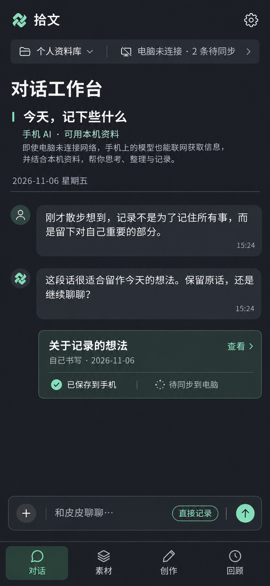

# 拾文 Android 客户端实施与架构说明

更新：2026-11-07。本文保留初始产品决策和架构推导；早期阶段计划不再作为当前进度来源。当前代码/验收状态以 [Android 交付状态](delivery-board.md) 和主线最后的验证记录为准。

**当前实现：** Android 子项目已包含原生 Room 资料库、独立资料库 registry、五栏 React/Capacitor UI、分会话手机 Agent、服务器节点配置、协调服务全量/增量同步、冲突/恢复页面、Markdown 与完整备份入口、分享收件箱，以及 DSH 插件/自动化/外部接入管理界面。同步与管理代码采用明确 library/node fencing 和写入回执。Android 0.1.0 正式签名 APK 已发布，现用设备的覆盖升级、素材保存和局域网同步已验证，详见 [交付状态](delivery-board.md)。本轮使用的浏览器 fixture 仅证明界面，不证明 Native bridge、真实模型、目标设备后台或 APK 升级。

**架构决定已锁定：** 手机保存完整本地副本，服务是可替换的协调节点；资料同步并不依赖把 Android 变成网页远程壳。桌面和 Web 当前共享既有服务的功能，不代表它们已经加入 Android 的完整离线同步协议。iPad、移动端互为同步节点、区块链/自动选主不在当前实现范围。

### 文档入口与决策边界

| 文档 | 负责的问题 |
| --- | --- |
| [架构决策与生命周期](architecture.md) | 各端角色、创建先后、协调恢复、备份换机、未来对等同步边界 |
| [同步协议](sync-protocol.md) | 身份、操作回执、全量/增量、初始化/汇合 API、文件与确认进度 |
| [页面与状态](ux-flows.md) | 用户操作入口、完整性、设备进度、冲突和恢复提示 |
| [移动端页面重设计方案](mobile-redesign-spec.md) | 2026-11-07 真机审查后的页面结构、交互、控件与验收提案；未实施 |
| [页面重设计执行计划](mobile-redesign-execution-plan.md) | 已选第 3 个视觉方向；全页面改动步骤、文件职责与真机验收要求，尚未实施 |
| [完整交付清单与并行分工](delivery-board.md) | 五栏导航、统一设置、DSH 功能覆盖、人设自动同步及剩余交付 |
| [原有菜单能力矩阵](dsh-menu-capabilities.md) | 插件、自动化任务、Agent 与记忆、外部接入、更多的实际组件和 API |
| [社区实现参考](community-implementation-reference.md) | 固定版本源码证据、采用方式与取舍 |

已确认并在当前实现中采用 React/Capacitor 页面、Kotlin + Room Repository、原生网络与文件桥、持久化任务/回执，以及单一中心协调协议。手机 Agent 使用独立模型配置和持久本机任务，不将整套 DSH Host 运行时塞进 APK。当前桌面/浏览器连接服务不自动拥有本地离线副本；此处的完整副本对象是 Android 与服务端资料库。

### 社区实现参考后的技术建议

按用户要求参考社区实现方式，继续自行开发拾文移动端。已抽样核对四个项目的源代码并记录固定 commit、文件证据和取舍，见 [社区实现参考](community-implementation-reference.md)。当前 Android 应用实际采用 React + Capacitor 界面与 Kotlin 原生能力分层；手机 Agent 使用独立任务/工具和本地模型传输，不 fork 社区应用或嵌入完整 DSH。

### 既有评审修订与当前实现

已按用户确认实现“服务端同步回执、手机同步前先查回执”。当前同步实现含持久 outbox、按原 requestId 对账、变更游标、完整性切点、附件依赖和冲突处理。下表记录对应的实现约束，设备覆盖情况见[交付状态](delivery-board.md)。

| 风险 | 当前实现约束 | 验收边界 |
| --- | --- | --- |
| 成功但 ACK 丢失，被自身远端事件误判冲突 | 回执与写入同事务；每轮先对账；变更事件包含 operationId/指纹；unknown 不等于失败 | 回归需覆盖丢 ACK 和恢复 |
| 服务端删除后不能完整保存手机修改 | 原子的 restore-and-update，恢复和写正文一次提交、一次递增版本 | 回归需覆盖并发编辑和恢复 |
| 多日离线编辑被压成一次同步日统计 | 持久活动链、原日期与来源、逐活动校验去重；只合并调度，不丢正式保存的中间事件 | 数据统计验收按活动日期核对 |
| 跨库复制遗留旧库附件引用 | 文本复制预览未复制附件，将库内引用转为来源说明，不带旧附件 ID/凭据 | 附件仍留在源库，目标副本明确标识 |
| 手机断开被误认为远端 Agent 已中断 | 分离连接状态与任务状态；重连查询原任务及事件，不自动重发 | 真实 DSH Host 整链由主线验收 |

### 本轮架构评审补齐

以下五项已落实为架构约束、API、界面状态与对应实现；具体验收证据仍按交付状态表区分。

| 问题 | 当前约束 | 验收边界 |
| --- | --- | --- |
| 两台设备同时初始化/恢复而覆盖目标 | 目标独占租约、递增 fencingToken、targetGeneration CAS；发布时复核，迟到 worker 不能提交或释放他人预留 | 仍需并发与迟到 worker 故障回归 |
| 换机导致旧活动重复计数/旧回执无法核对 | 活动按库内不可变 activityId 去重，originDeviceId 不改；新安装走所有者授权的同 epoch device-restore 对账 | 恢复验收检查完整活动与回执 |
| 附件暂缺被永久拒绝 | blocked-dependency 非终态，保留原请求；补齐后原 ID 重试，缺项等待不空转 | 回归补齐附件和重启场景 |
| 不完整恢复与完整发布规则冲突 | 缺项仅救援暂存，可只读预览/导出；补齐前不发布正常可写服务/Agent/完整确认，取消保留来源 | 分支恢复验收检查缺项阻断 |
| 合法长文超过 HTTP 批次限额 | 规范业务载荷单独分块暂存并引用，正文/来源/活动整体原子提交；inline 与引用使用相同语义指纹 | 大正文与丢 ACK 回归 |

## 1. 已确认的产品决定

- Android 子项目已在 `shiwen-dsh/android/`，与桌面和插件共仓，使用独立构建、版本与发布流程。
- 初始方案采用第二张设计图确立对话首页与保存回执；2026-11-07 重设计已选定本轮第 3 个方向「专注工作台」，详见 [执行计划](mobile-redesign-execution-plan.md)。保留直接记录入口。
- 手机是可独立使用的完整客户端：无需电脑、无需添加服务节点，也能长期管理自己的资料库，记录日记/想法、整理素材、创作文章、搜索和回顾。配置模型后可独立使用手机 AI；联网模型仍需要互联网。
- 手机资料库保留完整内容；连接服务的各资料库也在手机持有独立完整副本，不是近期缓存。完整范围包括正文、元数据、库内关联、保留的历史版本、活动统计及库内附件/原件；不包含服务器程序、路径、登录凭据或其他设备的模型 Key。连接电脑服务是可选能力，保留自动与手动双向同步。
- 同一资料库不受创建先后限制：电脑先建可完整同步到手机，手机先建也可接入服务并保留原库身份持续同步。同步完成并解决冲突后，各端资料在同一切点一致；任一端停用不删除其他端已保存内容。
- 数据保存在各端，服务是可替换的同步协调节点，不是唯一数据源。已完整复制到存活端的数据不会因单个设备丢失而丢失；尚未复制的修改不能据此承诺恢复。当前方案不引入区块链、自动选主或任意两端后台直接互联。
- 支持多个可自行命名的独立服务节点。各资料库的记录、草稿、上下文、凭据和同步队列相互隔离。
- 自动同步与手动同步共用同一引擎。某个节点失败不能拖住其他节点。
- 显示资料归属，区分“内容作者/来源”“创建设备”“当前同步状态”；改节点名称或地址不改变资料归属。
- 控制应用体积、列表渲染与同步批次；资料占用按真实全库大小提示，空间不足暂停同步并保留现有数据，不能自行改成近期缓存。7/14/30 天只用于回顾或列表筛选，不决定保存范围。
- 手机可直连用户配置的模型服务；可达时也能选择电脑端 DSH Agent。完全断网不承诺 AI 可用。
- 保留中英文、深浅主题、Markdown 编辑与可读排版。模型地址和模型名称可自由填写，不限定供应商下拉列表。

### 初始视觉依据（历史参考）

当前重设计以 [专注工作台](assets/mobile-redesign-selected.png) 为准；下图保留初始产品决策记录。



这是概念图，不是已实现页面。实施时保留对话优先、石墨灰/薄荷绿、底部输入和保存回执；移除图中额外出现的“对话工作台”大标题与说明长段，避免挤占聊天区域。“手机 AI”表示手机直连模型服务，不代表离线模型或默认具备联网搜索。

具体页面见 [界面与交互](ux-flows.md)，数据协议见 [同步协议草案](sync-protocol.md)。

## 2. 当前代码能复用什么

| 当前证据 | 已复用/接入 | 仍需验收或不在当前范围 |
| --- | --- | --- |
| `android/native/.../library/LibraryRepository.kt` 与 Room schema | 正式本机记录、版本、活动、关系、附件、分支、同步元数据；编辑和冲突用 CAS/幂等请求 | 最终 release APK、迁移覆盖升级与压力/长时间运行仍待主线验收 |
| `android/native/.../library/LibrarySyncCoordinator.kt` 与 `plugins/library/src/sync/` | 多库身份、bootstrap、push/receipt/pull、游标、冲突、协调恢复、附件依赖 | 有限平台/仿真主机已覆盖；所有网络/休眠/强停/不同 Android 厂商组合需真实设备验收 |
| `android/bridge/` 与 `android/web/` | 明确 libraryId/nodeId fencing、素材/创作/回顾、对话、设置、备份与外部接入 | DOM fixture 只验证呈现和交互，不能替代 Capacitor、SAF 或服务调用验证 |
| `LibraryImportExport.kt`、FileProvider/SAF、ShareInbox | Markdown 导入/导出、附件分享、完整备份/恢复、导入为新库和系统分享入口 | 公开 APK 中所有 picker、URI 授权和换机恢复组合仍需验收 |
| `integration/password-auth.mjs` 与 Android NodeSettingsStore | 节点密码登录、加密凭据、配置版本隔离、profile 快照与连接后同步启动 | 服务身份损坏、应用升级/密钥迁移和多设备长时恢复继续列入回归 |
| `plugins/mobile/`、`contracts/mobile/v1/` | 版本化身份/同步 API、幂等回执、权限与移动管理 Host adapter | 协议服务端最终并发/故障验收由主线记录；不要把旧 Workbench snapshot 当同步回退 |
| DSH `packages/api/session-controller` 与 remote session adapter | 远端会话、事件恢复、任务状态、工具审批和草稿的节点隔离适配 | 不在 APK 运行 DSH Host；真实收费模型端到端请求须由用户在手机设置模型后自行发起 |
| DSH Host 管理 API | 插件、调度、Profile/记忆、外部客户端的固定白名单管理入口 | 任意 DSH preset/YAML 编辑、所有 Skills/MCP 通用管理、完整 Typert Remote 不是当前已接页面 |

Android 不直接复制运行中的 SQLite，也不把 legacy `messages` 表当 DSH 原生会话。同步走版本化服务 API；不会把回环 MCP/HTTP 工具端口暴露到局域网充当同步接口。

## 3. 当前技术实现

下表描述当前工程采用的分层；它不是未来选择建议，也不是每个设备/版本的验收声明。

| 层次 | 建议 | 原因及代价 |
| --- | --- | --- |
| Android UI | React + Capacitor，本地页面随 APK 打包 | 通过有类型的 bridge 调用原生库；页面预览仍不能证明 APK 交互 |
| 本地存储 | Kotlin Repository + Room / SQLite | 业务写事务由原生 Repository 完成，正文、活动、outbox 与回执分开管理 |
| 异步与状态 | 原生协程、任务状态与 bridge；React 消费本地投影 | 页面重建后按资料库/会话重新读取，写入先保存 pending 标记再核对回执 |
| 网络与凭据 | 原生 HTTP/会话存储、按节点配置隔离；安全对话框保存模型 Key 和登录凭据 | Web 页面不接收密钥；服务节点请求携带显式 nodeId/configRevision |
| 同步 | 插件 Host API、`plugins/mobile/`、版本化 schema 与原生 SyncCoordinator | full bootstrap、增量、回执、分支和附件不通过复制 SQLite 实现 |
| 手机 Agent | 独立手机任务控制、模型传输、本地工具与远端 DSH 会话 adapter | 不捆绑完整 DSH Host；收费请求未知时不自动新开请求 |
| 文件 | SAF、FileProvider 与内容哈希校验的 archive helper | JS 不获取任意文件路径；用户通过系统文件选择器完成导入/导出 |
| 合同 | JSON schema、JS/Kotlin fixtures、bridge 类型和 adapter | 页面桥、资料同步和远端 DSH session 协议分开维护 |

项目当前有独立 Android 工程和锁定的构建工具链。最低系统版本、签名发布及支持设备仍以最终 APK 的发布说明为准；尚未发布 APK 前，不承诺某个 Android 版本范围已完成真机验收。Capacitor 提供 JS 到原生 API 的桥接，不包含 Node 运行时，也不会把现有在线 Web 页面自动变成离线应用。[Capacitor 插件](https://capacitorjs.com/docs/plugins)、[离线优先架构](https://developer.android.com/topic/architecture/data-layer/offline-first)

共享 UI 已通过 Android 的 native bridge 与 Repository 分离；DSH Web 仍由宿主运行，手机资料读写走本地 Room。后续 iOS 可以复用部分 React 展示代码，但存储、调度和凭据需要单独实现并验收，不承诺零成本迁移。

桥接只向 APK 内置可信页面开放有类型的业务方法，拒绝远程页面、任意 SQL/路径/shell。每次调用绑定 libraryId、requestId 和页面/连接代次；失效订阅不能写新库。大正文分页读取，保存必须等待原生事务回执；超时先对账后重试。原生端不会把密码、Cookie 或模型 Key 通过普通查询返回页面。

## 4. 当前代码组织

```text
android/                       拾文移动端子项目（独立 package.json）
  web/                         本地 React 页面、导航与移动端交互
  bridge/                      原生能力类型、调用与事件订阅
  capacitor.config.ts          本地资源与原生工程路径
  native/                      Android Gradle 工程
    app/                       应用入口、Capacitor 插件和系统集成
    core/model/                领域类型与 LibraryContext
    core/data/                 Room、Repository、完整资料库及草稿
    core/network/              节点认证、HTTP、模型传输
    core/sync/                 outbox、游标、调度、冲突
    core/agent/                手机任务控制、运行时适配、工具回执
    gradle/libs.versions.toml   锁定原生依赖
    schemas/                   Room schema 快照
packages/workbench-ui/          从现有插件提取的可共享展示和平台接口
contracts/mobile/v1/            接口 schema、错误码、示例与兼容 fixtures
plugins/mobile/                 DSH 内的移动端 API/Agent 适配
plugins/library/src/sync/       同步身份、日志、回执与事务协调
tests/mobile-*.test.mjs          服务端协议及写入口测试
scripts/check-mobile-sync.mjs   临时库端到端验收
docs/android/                  本计划、协议、交互与社区实现参考
```

`android/`、`contracts/mobile/v1/`、`plugins/mobile/` 与 `plugins/library/src/sync/` 已存在；上面的树用于定位职责，不保证每个示意子目录都单独成为文件夹或 Gradle module。桌面与 Android 使用不同构建入口，Android 构建不应启动桌面打包。

根 Node 构建与 Android 原生构建各自运行；打包规则应继续明确区分 Desktop、DSH 插件与 Android APK，避免把移动插件当桌面插件打包。

## 5. 身份、节点与本地存储

三个概念必须分开：

- `nodeId`：手机保存的连接配置 ID；名称和地址可改。
- `serverId`：服务安装身份；用来发现地址背后的服务已更换。
- `libraryId`：资料库的稳定身份；记录归属以它为准，不依赖节点名称、IP 或设备昵称。

一个服务当前发布一个资料库。同一 `libraryId` 重复添加时复用已有本地副本，地址作为候选连接；不建立第二份可写副本。不同 serverId 声称同一库时必须核对协调代次与迁移状态，不能同时向两个独立协调端写入。此限制不阻止手机继续本地编辑；它约束的是协调服务，而不是资料库的生存依赖。

手机维护一个轻量 registry 数据库保存节点、资料库映射、同步完成度和当前选择；每个 libraryId 对应一个本地数据库文件；手机先创建的库接入同步后继续使用原文件和身份，不再额外创建同库副本。手机资料库在首次启动本地创建，不依赖 serverId；registry 区分 standalone/coordinated/paused/rebind-required，并独立记录 initializing/complete/incomplete。仅本机库不产生虚假的待上传数量，所有资料库的正文、版本与库内附件均不按缓存淘汰。每库包含记录元数据、完整正文和保留版本、附件/原件、基线、草稿、outbox、冲突、同步状态、本地活动和会话。凭据另存。每个请求绑定不可变的 `LibraryContext`，不能在网络返回时读取一个可变的“当前库”来决定写入目标。

### 创建先后、停用和协调节点替换

- **电脑先建**：手机以原 libraryId 加入，完整初始化后双向同步。
- **手机先建**：通过“为此资料库启用同步”，将完整快照初始化到已授权且未承载其他库的服务位置。保留 libraryId、recordId、版本关联和活动身份，不按普通导入重新计算写作统计；初始化中断可恢复，完成前手机继续保留唯一原始库。
- **目标已有不同资料库**：作为另一库添加，或另行显式迁移/合并；不得按名称猜测同库或静默覆盖。跨库复制仍产生新 recordId，与同库加入同步不同。
- **一端停用**：存活端继续使用完整本地数据及手机 AI，不因失联删库或锁住记录功能。缺失范围是未曾同步到存活端的变化；初次初始化未完成的端不能冒充完整接管来源。
- **协调服务丢失**：可从完整存活副本恢复到新协调服务，保留 libraryId 并建立新协调代次。其他端重新授权后先核对身份和版本分支，再汇合其未同步修改；不同分支发生冲突保留双方，不用新服务的快照直接覆盖所有端。
- **旧服务返回**：旧代次必须停止原同步通道，显式恢复/迁移后才重新加入。客户端不能悄悄同时信任新旧两个协调节点；不承诺无网络分区时的自动选主或共识。
- **完成度可观察**：“已保存本机”“协调服务已接收”“哪些已登记设备确认到哪个切点”分别显示。一次上传成功不等于所有端已拥有该修改；离线端显示最后确认时间，未知不标为已备份。同步删除会传播，因此多副本容错不能替代保留历史的备份。

### 完整本地副本与来源

- 手机独立库与连接服务的副本都保存完整资料，不提供默认“仅最近 30 天”或历史正文自动淘汰模式。完整指该库按保留政策现存的正文、元数据、版本、关联、活动和库内附件/原件；普通外部网页链接不等于必须镜像整个外部网站。
- 新连接先获取一致快照清单和切点，分批复制全库数据并校验完整性。可优先传当前打开记录以改善等待体验，但后续仍继续全部传输。初次复制未完成时明确显示进度、未完成项和空间不足原因，不能标为“完整副本”或“已同步”。
- 每轮增量同步同时补齐受影响正文、版本、活动和附件；本地已完整同步的内容长期保留，清缓存只处理可重建的索引/缩略图/临时文件。空间不足暂停并让用户管理容量或明确移除整库，不自动删除历史正文。
- 初始复制或增量更新中，正文/附件尚未到达时显示对应状态，不以空内容替换。完成到某个同步切点后，可离线检索、编辑全部该切点的资料并计算本库完整历史统计；断网后未知的远端新增变化，以最后同步时间说明。
- 库内附件/原件与正文同属完整性范围，上传与下载均按散列校验、断点续传；包括手机先建库/恢复/已有导入对象的传输。新增拍照、录音等采集入口不是这套传输协议自动附带的功能。
- 当前仅 `origin` 枚举还不能充分描述“AI 整理用户原话”。协议新增处理方式与来源引用，保留原有段落来源；旧内容保持未知，不倒推作者或创建设备。
- 不同 libraryId 之间“复制到其他资料库”是本地可恢复的复制/归档事务；同库启用同步不走此路径；跨库复制产生新 ID 并记录来源库，不跨库建立文章引用。过程需防止崩溃造成丢失或重复，详细规则见协议。

### 同步主流程

**认证与当前协调代次核对 → 查询本设备未确认操作的服务端回执 → 拉取并识别资料变化 → 上传剩余修改 → 再次拉取与确认进度。** 自动、后台和手动同步共用这套流程。服务端操作回执和全库变更日志分开：前者回答“我的上传成功了吗”，后者回答“还有什么内容变了”。普通文本日志不参与成功判断。

applied 只确认对应本地代次；conflict 进入冲突处理；rejected 展示明确原因；暂缺依赖的 blocked-dependency 不写终态回执，补齐后重试原请求；unknown 保留为结果未知并使用原 ID/请求重试。服务端业务写入、活动统计、变更日志与成功回执必须在同一事务中提交。同一操作的旧回执不能清掉后续本地修改，也不能降低已观察到的同代次服务版本。appliedCursor 只表示变更/下载任务已持久化；completeCursor 还要求所有正文、历史、活动与文件齐全。库内完整性、是否存在冲突/待上传，以及其他设备是否确认分别展示。详见 [同步协议](sync-protocol.md)。

## 6. 连接、认证和传输

先支持用户输入名称、HTTP(S) 根地址、密码；不把自动发现作为离线同步的前置条件。

- 复用独立服务的密码会话：`/auth/login`、`/auth/status`、`/auth/logout`、设备撤销。原生网络层发送服务器期望的 Origin，Cookie 按精确 origin 和节点隔离；不放宽浏览器 CSRF/CORS 规则。WebView Cookie 不天然按端口隔离，不能把同一 IP 不同端口的服务放进共享 Cookie 容器就视为完成隔离；远程网页不得接触本地业务桥。
- 更改地址时不把旧 Cookie 或密码自动发给新地址；重新登录并核对资料库身份后，才允许接回原离线副本。名称改动不需要重新登录。
- 登录后读取身份与能力握手；旧服务没有同步能力时提示升级，保留本地记录，禁止偷偷调用旧写接口“凑同步”。不支持同步的普通 DSH 可另用浏览器访问。
- 新插件默认关闭同步，独立服务 profile 显式启用；普通插件宿主要明确启用并配置可用认证。不得因新路由漏掉 Host admission 而变成匿名访问。
- 新同步/Agent 路由逐次验证会话；长流需响应设备撤销。仅限制 URL 前缀不足以保护认证。
- HTTP 局域网兼容属于显式节点选择：提示链路未加密，只允许用户保存并允许的局域网目标；拒绝跨 origin 重定向和向公网 HTTP 发送凭据。HTTPS 正常验证证书，不添加“信任所有证书”。资料库 ID 不能替代 TLS 的服务真实性验证。
- Android 动态 IP 节点无法逐个写死到静态 network-security-config；当前实现把局域网 HTTP 请求集中到受节点 allowlist 和私网解析检查约束的原生客户端，模型调用默认 HTTPS。DNS 变化、重定向及不同 Android 版本的网络行为仍需按[交付状态](delivery-board.md)回归。
- API 37 局域网权限按需申请，拒绝后仍能写本地内容，并显示“局域网权限未允许”，不能笼统报“密码错误”。[局域网权限](https://developer.android.google.cn/privacy-and-security/local-network-permission?hl=en)、[网络安全配置](https://developer.android.com/privacy-and-security/security-config)
- Keystore 用于保护加密密钥，不是直接保存任意密码字符串；加密后的会话与模型凭据放应用私有目录。系统云备份排除凭据、资料和待同步队列，避免普通系统恢复复制 deviceId 或泄露个人资料；应用导出另行显式操作。[Keystore](https://developer.android.com/privacy-and-security/keystore)

## 7. 手机 AI 与电脑 Agent

### 两种执行方式

| 模式 | 执行位置与检索范围 | 保存与失败行为 |
| --- | --- | --- |
| 手机 AI | 手机直连模型供应商；使用手机资料库或当前服务库的完整本地副本（初始同步未完成时明确检索范围） | 通过本地工具保存；仅已关联服务的副本进入同步队列，模型请求失败不影响已保存内容 |
| 电脑端 Agent | 当前节点上的原生 DSH 会话、模型与工具 | 资料由服务端写入，再同步到手机；不回写第二份重复记录 |

手机模型配置支持供应商名称、Base URL、模型名称、Key、能力参数；优先实现明确的 OpenAI-compatible 文本/工具调用协议，再添加单独 provider adapter，不承诺任意供应商只换地址就兼容。

### 避免重新实现完整 Agent 底座

电脑端继续使用 DSH。当前服务端 adapter 复用 DSH SessionController 和宿主交互能力；Android 不启动第二个 DSH SDK/Host 子进程打开同一资料库。手机端实现独立会话、结构化工具与上下文管理，并用原生任务、回执及恢复状态管理请求，不把完整 Hermes、Node 或 DSH Host 打进 APK。手机 AI 与远端 DSH 会话是两个清楚区分的执行位置，页面预览不代表模型端到端验收。

必须实现的移动能力：

- 当前库的 search/read/save/update/delete/restore/review 工具；保存原话可引用本地已完成用户消息，来源由工具执行层校验；写操作用持久 callId 防重复。
- 手机工具按当前库隔离读取和检索；写入通过持久请求 ID 与原生回执完成。跨库复制、删除等操作显示影响范围并要求确认；记录提供历史版本和回收站恢复。资料正文不能赋予工具权限，导入的 Skill/MCP 配置不因同步自动启用。
- 本地存储与模型处理位置分别说明：调用云端模型时，仅提交本轮授权检索/选中的上下文；凭据不进入内容或日志。未支持的联网收集、文件操作或桌面工具显示不可用，不伪装成功。
- 用户输入不自动变成长期记忆；明确要求记住时产生候选，经确认后注入。
- identity/soul/user/已确认记忆、最近对话、按需资料检索按预算组织；超限先裁剪检索结果，再摘要旧对话；工具定义与输出预算预留，摘要保留来源 ID。
- 手机与服务端的模型配置、执行状态、临时上下文相互独立。同步人格/已确认记忆使用单独开关和版本；候选不能因同步自动变成已确认。
- 手机会话历史默认仅本机，可按库选择同步为会话档案。档案不假装是可恢复的原生 DSH 运行时，也不自动恢复工具执行；服务端会话仍以 DSH 为权威。
- 远端适配 API 要覆盖创建、列表、分页、发送、取消、断线重连、工具审批、用户提问；无法承载某种交互时阻止执行并解释，不自动授权。
- Agent 输出必须有执行节点和检索范围。离线待发草稿不会因网络恢复自动发送收费模型请求；会话切换节点/模式采用独立 thread，不静默带入其他库的上下文。

当前远端会话通过 DSH SessionController adapter 暴露创建、列表/分页历史、发送、状态、事件、取消和交互审批操作。请求绑定稳定 clientRequestId、会话和节点配置；事件按 DSH 持久序号续接。适配层在提交结果未知时先查询原生会话并对账，不自动重发收费请求，显示“结果待确认”。真实 Host 与设备链路的结论见交付状态。

资料同步的后台任务不承担模型生成，按执行位置分别恢复：

- **手机 AI**：切后台先持久保存已收到文本；只有实际取消、连接终止或进程重建后无法恢复的轮次才标为中断，不能因一次界面切换就判失败。用户重新发起前先核对本地工具执行回执，避免重复保存。
- **电脑端 Agent**：手机失联只改变连接状态，显示“连接中断，执行状态待确认”，不推断远端已停止。手机持久保存 nodeId/libraryId/sessionId/clientRequestId/服务端 turnId（如已收到）和事件游标；重连先查询同一任务，再续接事件。若正在运行就继续观察，若完成则补齐结果；用户明确取消才发送取消请求，等待服务端确认后再标为取消。
- 无法确认远端是否已接收时保留请求身份并查询，不自动重发或另开一轮。普通资料同步回执不能当作 DSH turn 的完成证明；两套请求状态分别维护。不把收费模型请求当作普通 outbox 自动重试。

## 8. 当前实施状态与剩余验收

早期分阶段计划只保留作开发历史，不再是本项目的当前看板。实现项、测试范围与未验收边界统一更新在 [Android 交付状态](delivery-board.md)。当前工作主要收敛最终 Android 构建、长文/恢复相关设备回归、迁移覆盖升级和发布说明。

| 工作面 | 当前状态 | 最终需要补充的证据 |
| --- | --- | --- |
| 本机完整资料库与记录编辑 | 有原生 Repository、Room、素材/创作/回顾、恢复、导入/导出/备份代码；存在隔离 Repository 和文件测试 | 主线确认最终 APK 对应源码/资源；真机安装后重启、切库、迁移与恢复 |
| 服务端副本同步 | 有身份、bootstrap、变更/回执、push、冲突和协调恢复实现；连接时 UI 自动启动目标库同步 | 真实目标设备网络中断/恢复、长任务进度、错误重试与完整性切点 |
| DSH 管理与会话 | 节点绑定的管理页、远端会话与 Profile adapter 已接入 | 目标设备 UI/Host 整链回归；不将真实模型收费调用用 mock 代替 |
| 主题、语言、响应式与文件交互 | 页面/本机设置、SAF、FileProvider 和 native dialogs 有实现 | Play Store/系统文件选择器行为、键盘、进程终止、Android 版本差异 |
| 发布 | 目前没有公开 APK；桌面和插件版本序列独立 | Release 签名、versionCode、升级兼容、校验和、明确支持设备和 limitations |

### 后续对等同步边界

当前实现仍采用可替换的中心协调服务；移动端之间没有点对点发现、自动选主或在协调服务离线时互相同步。完整本地副本能保留各端已同步的数据，但不能恢复从未到达存活节点的变化。未来若改成多端对等，还需要新的因果/冲突/退役与迁移协议，不是打开一个选项即可完成，详见 [架构决策](architecture.md)。

## 9. 测试、性能目标和发布

### 验收矩阵

- Android 最低支持版本、API 36/37 模拟器；至少一台实际使用手机，补测另一种后台限制较强的系统时记录型号。真机未提供前明确标为未验收。
- 360/390/412dp 窄屏、横屏、大字体、中英文、深浅主题、手势返回、输入法弹出、系统分享进入、低存储。
- 零节点独立使用：全新安装不登录服务，记录日记、整理素材、创作、搜索和回顾；配置模型后完成手机 AI 对话和本地工具调用。离线重启、编辑超过 30 天的本机记录及清理缓存后，原始正文/版本/活动不丢失。
- 本轮评审故障验收：同目标并发 setup/失效租约、同 epoch 换机后旧手机回归、附件补齐后原请求重试、不完整来源取消/重启、近正文上限的中文大载荷与丢 ACK。对照协议第 12 节逐项保留数据/回执/统计证据，不能只看 UI 成功。
- 创建/接管验收：电脑先建、手机先建两种顺序均保留同库与记录身份；停用任一端后存活端可持续使用；协调节点恢复后，各端未同步分支不丢失、不重复统计；已切换客户端不向旧服务双写；未获知切换的旧分支可保留并显式汇合。
- 服务库全量验收：超过 30 天的正文、历史版本、活动、关联和库内附件复制完成后，关闭服务并在手机搜索/阅读/编辑/回顾；比较快照清单、内容散列与统计。复制中断能续传；空间不足不会悄悄转成近期保存或误报完整。
- 两个服务 A/B、一个手机；另加第二个客户端制造并发。覆盖 Wi-Fi 切换、无互联网但 LAN 可达、同 Wi-Fi 但服务不可达、休眠、强停后重新打开、重启、连接撤销。
- 每库 10,000 条记录及其全部正文、历史版本、活动、附件清单，包含 1 MB 单条正文进行分页和检索测试；补充大附件中断续传。目标本地首页可交互 <1 秒、本地正文打开 <300ms（在选定基准真机上测量，不是当前承诺）。
- 协议错误、cursor 过期、服务回档、创建确认丢失、在途继续编辑、删除冲突、重复 ID、来源/emoji/跨日时区、移动端离线统计和跨库复制崩溃测试见协议文档。
- Agent 模拟服务补测：手机进程被杀但远端继续写资料；重连时任务已完成或仍等待审批；发送响应丢失；取消请求未收到确认。必须找回原任务，不重复生成或自动批准；再用授权测试模型覆盖真实流式链路。
- APK、安装空间、冷启动内存、后台电量仍需在目标设备建立基线；不捆绑 Electron/Node/本地大模型。没有数据前不填写包体或性能数字。

### 当前构建与验证命令

以下命令对应当前工程。实际运行范围和通过情况以 CI/主线验收记录为准：

```sh
# 仓库根目录
npm test
npm run check:source
npm run test:mobile
npm run check:mobile-kotlin

# 移动子项目，在仓库根目录执行
npm --prefix android ci
npm --prefix android run check:ui
npm --prefix android run build
npm --prefix android run sync

# 在 android/native/ 执行
./gradlew test lint assembleDebug
./gradlew connectedCheck
# 配好签名后才可发布
./gradlew assembleRelease
```

Room schema 变化必须有迁移测试，不使用 destructive migration 清掉离线队列。[Room 迁移指导](https://developer.android.com/training/data-storage/room/migrating-db-versions)

### 兼容与发布策略

- Android 使用独立 `versionName` / 单调递增 `versionCode`，Git tag 建议 `android-vX.Y.Z`；桌面和插件继续自己的版本序列。应用 ID 以当前 Gradle 配置 `io.github.wyf929597870.shiwen` 为准；首次签名发布前确认它不再变更。
- 提交源码、Gradle wrapper、依赖锁定/校验信息和 Room schema；忽略 `.gradle/`、build、local.properties、签名文件、密钥、真实数据和安装产物。
- Release 签名私钥由用户持有或配置为 CI secret，不生成后遗失、混用 debug key 或提交 Git；缺签名时只能交付标明用途的 debug 包，不能声称可持续升级。
- APK、SHA-256、最低服务协议/插件版本、已测设备与限制上传 Release。安卓、Linux、插件三条发布线分别保留最新包；新包成功上传并验证后再清理旧包，历史标签/说明保留。
- sync v1 按 capability 和 protocolVersion 判断；未知字段前向兼容，未知必需能力拒绝写入。Android UI 版本不等于协议版本。
- 新服务仍兼容旧 Web/桌面入口；旧服务不支持同步时 Android 仅保留本地能力并提示升级。不得把旧快照 RPC 当作同步回退路径。
- 发布前使用隔离数据与导出的副本验迁移；数据库迁移失败保持原库可恢复。老版本未理解新 schema 时不得继续写入，必须提供最低写入版本检查，回退服务需连同迁移前副本并明确期间新数据的导出恢复步骤。

## 10. 当前范围与仍需验收的事项

核心代码已实现 React/Capacitor 与 Kotlin/Room 分层、离线资料库、协调服务同步、远端 DSH 会话和文件备份恢复。尚未完成的事项以[交付状态](delivery-board.md)为准：最终 APK 发布、不同设备/系统后台和升级迁移覆盖、真实模型供应商行为及发布签名。这里不把这些验收边界写成“功能尚未实现”。

当前范围包含文本资料的离线与双向同步、当前节点的手机/远端 AI、可选人格/记忆和会话档案、库内附件/原件复制与离线读取。暂不承诺 iOS、端上大模型、跨服务主库互相复制、自动跨库知识融合、离线协同实时编辑、任意桌面 Skill/MCP 在手机原样运行。Android 系统语音键盘可正常输入，不额外默认建设语音转写服务。

库内附件/原件通过受控上传下载服务于导入、完整同步和恢复。新增拍照、录音及自动网页抓取等采集入口不在当前范围。跨库复制只复制文本，经用户确认将库内图片/附件引用转换成来源说明，原件留在源库，不产生不可访问的目标附件 ID。若以后加入拍照/文件上传或完整附件跨库复制，需复用 blob 上传确认、散列去重与引用提交顺序，并另做交互/权限验收后再开放入口。

浏览器移动适配继续存在，但不因新增 APK 自动获得离线同步。本计划不改动已发布 v0.1.7 / v0.2.0-dev.2 产物。
