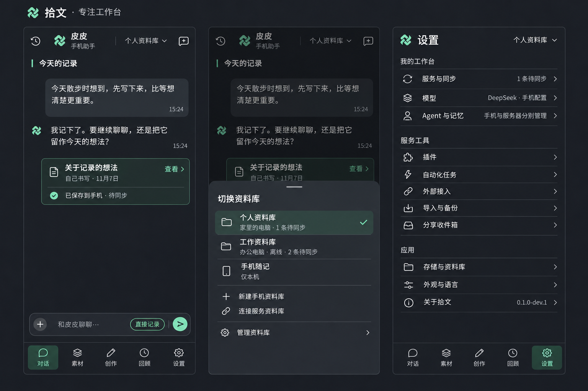

# Android 页面重设计执行计划

> 范围更新：Android 功能收敛方向见 [移动端精简范围](mobile-scope.md)。本文保留历史背景，其中要求移动端与桌面管理能力对齐的内容不再作为现行要求。

日期：2026-11-07。状态：**执行计划，已纳入本轮 5 项自评审修订；按用户最新要求，全部页面完成后统一真机验证。应用代码尚未按此计划修改。**

用户选定本轮第 3 个方向「专注工作台」。本计划将 [结构与交互方案](mobile-redesign-spec.md) 转为可执行步骤，覆盖五个主页面、全部已有管理子页和原生配置窗口。

## 1. 目标与视觉依据

采用石墨灰、薄荷绿、紧凑顶栏、细分隔线和清晰的文字层级。内容占据主要空间，资料库通过顶栏入口打开选择面板，设置首页仅保留分组条目。浅色主题沿用相同结构和语义。

本图确定了对话、资料库选择面板和设置首页三个视图。素材、创作、阅读、编辑、回顾和管理详情仍需按同一视觉体系补齐，不能声称已有完整设计稿。图中的库名、计数、版本和同步状态只是示例，实际界面必须读取真实数据；画板外的标题、背景光效与手机边框不属于应用界面。

完成后的关键变化：

- 打开应用先看到对话内容与输入区，资料库信息不再占用一整块固定区域。
- 素材与创作以列表和正文为主，属性、筛选和次要操作按需展开。
- 设置按功能逐层进入，插件、任务、人设、同步等能力均有明确入口。
- 按钮、选择框、输入框和原生弹窗保持一致；键盘弹出、大字体和横屏时操作仍然可达。

## 2. 改动范围与减法原则

复用现有 React / Capacitor 页面、Kotlin 原生能力、bridge、Repository 和服务 API。本轮调整展示、页面组织与必要的交互状态，不修改同步协议、数据库结构、Agent 执行机制或凭据存储方式。

减法落实到代码：

1. 删除被替代的固定资料库区、重复标题、重复入口和废弃样式。
2. 仅抽取真正重复的顶栏、页面框架、表单行、状态提示和选择面板；不建通用页面生成器，不引入另一套路由/全局状态框架。
3. 整理现有样式入口，按模块归类；不继续堆叠覆盖规则和特殊选择器。
4. 保留防止跨库写入、重复保存、草稿丢失的现有约束。减少的是展示层重复判断和信息堆叠，不能删除正确性保障。
5. UI 范围外的问题单独记录根因和影响，避免借重设计扩大重构。阻断当前流程的问题才纳入必要修复。

现有能力以实施起点的源码、真实调用入口为准，[能力矩阵](dsh-menu-capabilities.md) 用于辅助核对，其中历史描述不直接作为当前功能结论。阶段 0 将每个操作映射到新入口与验收项；发现能力文档过时则修正文档，不借机扩展功能。没有实现的接口、权限或服务能力，显示明确边界，不补一个无法工作的按钮。

## 3. 执行顺序与阶段出口

依赖顺序为：入口与状态规则 → 代表性页面稿及必要控件 → 应用框架 → 日常页面 → 设置及管理 → 统一真机验证、修复与交付。开发期间逐组执行构建、相关自动化测试和隔离界面检查，不要求用户反复连接手机或安装中间版本。原生窗口与系统适配随页面实现，实际设备行为集中在阶段 6 验证；此前标记为待验，不阻断其他页面开发。

### 阶段 0：固定基线，补齐页面状态设计

步骤：

1. 记录当前源码状态、安装版本、构建方式和已有测试结果。工作区已有大量未提交内容，逐项识别本轮改动，不覆盖或回退既有工作。
2. 建立操作级迁移清单，将审查发现逐项映射到当前源码入口、新入口、整改动作与验收证据；第 3.1 节提供最低覆盖范围。
3. 在选定的三个视图之外，仅补齐列表、阅读、编辑、回顾、管理表单五类代表布局。其他同类页面复用规则；空、加载、错误等采用状态表说明，仅为键盘/大字体等确实改变结构的状态补图，不逐页逐状态绘制独立稿。
4. 明确基础尺寸、颜色、字号、圆角、图标和深浅主题；以实际手机逻辑视口适配，不机械缩放整张三联图。
5. 优先复用已有隔离预览数据。当前页面依赖 Native bridge，浏览器预览若缺入口，仅建立开发预览入口，不能让模拟数据进入正式构建或替代原生调用。

产出：页面/状态覆盖表、补齐的关键页面稿、视觉参数表和基线记录。

出口：所有已有功能都能找到新入口；最容易挤压空间的键盘、大字体、长名称布局已有处理方式。后续可连续实施，无需每完成一页就要求用户再确认一次；只有实质改变已定产品行为时再确认。

### 阶段 1：统一基础样式与控件

主要位置：`android/web/style.css`、`theme.css`、`record.css` 及共用 UI 组件。

步骤：

1. 整理颜色、间距、字体、边框、圆角和层级变量，统一深浅主题。
2. 统一按钮、图标按钮、输入框、文本域、选择项、复选框、开关、表单标签、错误提示、加载/空态。
3. 使用一致的标准图标库，保留拾文品牌图；替换分散图标，避免混用字符、手绘路径与不同风格图标。
4. 选择面板统一标题、关闭、选中态和最大可用高度；长列表在面板内部滚动，关闭后恢复触发点焦点。
5. 仅抽取已出现重复布局或重复交互的组件；一次性表单保持就地实现，简单视觉统一优先使用样式类。先满足阶段 2 的框架与记录流程，其余控件随页面迁移补齐，不预建整套组件库。清理已被取代的样式，不因每个控件新建一层包装。

出口：控件在深浅主题、中文/英文、长标签和禁用/错误态下可读、可触达；默认触控目标至少 48dp，不用缩小字体解决溢出。

### 阶段 2：重做应用框架、资料库入口与导航

主要位置：`android/web/main.jsx`，必要时涉及原生 `MainActivity.java` 和主题资源。

步骤：

1. 移除常驻大资料库区及全局开发版本横条，改为紧凑顶栏。版本移至「关于拾文」。
2. 资料库入口打开底部面板：当前库、其他库、简短连接/同步状态、新建、连接服务、管理。库的身份和服务节点身份分别处理。
3. 五主页面保留底部导航；阅读、编辑及设置子页使用返回式页面，不与底部主导航争抢空间。
4. 按第 3.2 节一起处理搜索、筛选、已加载列表和滚动位置；进入新子页从顶部开始，返回上级恢复相匹配的内容与位置，不能仅保存 scrollTop。
5. 明确返回顺序：先收键盘/关闭弹层，再按页面层级返回；未保存编辑沿用草稿和确认规则。
6. 键盘出现时让输入区和操作区完整可见，收起不必要的底部导航。统一 WebView、系统栏与键盘的边距处理，避免两处重复补偿。
7. 保留切库前的忙碌、草稿和待确认保存检查；切换后的查询、草稿和回执仍绑定正确 libraryId。同一次应用运行中保留当前主栏目，按第 3.2 节恢复目标库的状态，不带入旧库详情或任务状态。

**开发阶段检查：**通过构建、受影响的自动化测试和隔离预览检查「对话 → 直接记录 → 保存 → 查看正文 → 返回对话」的页面衔接；模拟保存只证明界面状态流转。真实保存、重启恢复、键盘、系统返回、系统字体和原生窗口均列入阶段 6，不要求此阶段安装到用户手机。

出口：框架代码、构建与隔离检查通过，草稿持久化与保存确认链路保持原有实现，可继续迁移后续页面。设备相关项明确记为待验，不将浏览器模拟结果写成真机通过。

### 阶段 3：完成对话与直接记录

主要位置：`ChatPanel.jsx`、`RemoteChatPanel.jsx`、`main.jsx` 中的直接记录编辑区。

步骤：

1. 手机与远端对话使用一致的视觉框架，紧凑展示助手名称和执行位置；会话历史、新会话、助手选择按需打开。
2. 收敛空态说明和工具设置；已有对话以消息正文为主。
3. 重排输入区、附件入口、直接记录与发送，处理多行输入和键盘可用高度。
4. 保存结果用紧凑回执展示标题、内容来源、保存位置和真实同步状态；「AI 帮忙保存」不能自动等于「AI 创作」。
5. 保留手机任务、远端会话的独立运行逻辑，以及工具审批、中断、重连恢复和失败提示。统一外观不等于合并执行状态。

出口：空态、长对话、长输入、工具审批、保存回执和断连提示完成实现，相关构建、自动化回归和隔离界面检查通过；真实保存、退出重进与切库隔离的设备验证留到阶段 6。

### 阶段 4：完成素材、创作、阅读、编辑与回顾

主要位置：`RecordPanel.jsx`、`MarkdownView.jsx`、`ReviewPanel.jsx` 及编辑区。

步骤：

1. 素材与文章列表采用同一排版节奏，标题为主、日期和必要状态为辅；搜索放在列表上部，筛选按需展开。
2. 只提供有实际含义和接口支持的筛选项。创作列表不重复提供无效的素材类型筛选。
3. 阅读页让正文占主空间，日期、来源、标签和原件进入紧凑属性区；保留 Markdown 可读排版与原始内容。
4. 编辑页首屏直接可写正文；标题、类型、来源、日期、标签按清晰层次组织；保存入口始终可达。
5. 创作保留文章编辑、预览、关联素材与发布前检查的已有能力及真实边界。
6. 回顾保留当日、近 7/14/30 天和自然月，采用统一范围入口、指标与明细布局，不改统计口径。

出口：列表到正文、编辑返回、长文滚动、筛选、来源修改和日期统计完成实现，无数据与查询失败明确区分；通过相关构建、测试和隔离检查。在第 3.1 节清单区分开发检查结果与待进行的真机验证。

### 阶段 5：完成设置首页与全部管理子页

主要位置：`SettingsPanel.jsx` 及下表模块。先按第 3.3 节明确服务选择，再拆页面层级、迁移内容，避免将原有长页面重新包进一张大卡片。

| 分组/页面 | 现有主要模块 | 执行内容与验收重点 |
| --- | --- | --- |
| 设置首页 | SettingsPanel | 我的工作台、服务工具、应用三组；只显示入口和短摘要，不展开表单 |
| 服务与同步 | SettingsPanel、LibraryReplicaPanel | 节点列表/详情分开；连接、自动/手动同步、进度和冲突有明确入口；地址、登录状态和库归属清楚 |
| 冲突与恢复 | LibraryReplicaPanel、RecoveryPanel | 冲突选择和高级恢复独立页；保留各阶段的限制与确认，不把恢复误写成普通同步 |
| 模型 | ModelConfigDialog.kt | 自由配置提供商地址和模型；密码/Key 留在安全原生窗口，表单主题与布局统一 |
| Agent 与记忆 | LocalAgentProfilePanel、AgentSettingsPanel、AgentProposals | 先选手机/远端管理范围，再进入支持的文档与记忆；候选、已确认状态和保存目标明确 |
| 插件 | ManagementPanel、PluginDetailsPanel | 列表、详情、版本、安装/更新、配置分层；创建插件入口保留真实执行去向 |
| 自动化任务 | ManagementPanel、ScheduleTimingFields | 列表与新建/编辑分开；规则、时间、时区、启停和运行历史可读 |
| 外部接入 | 对应管理页面、ExternalClientTokenDialog.kt | 客户端列表、权限、授权/撤销反馈；凭据安全展示，不混淆同步地址与外部工具地址 |
| 导入与备份 | LibraryTransferPanel | Markdown 导入/导出与完整备份/恢复分清；目标库、系统文件选择和结果可追踪 |
| 分享收件箱 | ShareInboxPanel | 空态、有内容、预览、目标库与保存反馈；保留来源 |
| 存储与资料库 | SettingsPanel、库管理模块 | 库名、容量、完整性和管理动作集中；内部标识折叠展示 |
| 外观与语言、关于 | SettingsPanel、i18n | 深浅/跟随系统、中英文和实际构建版本；移除重复主导航入口 |

原生窗口还包括 NodeSettingsDialog、ServerSecretDialog、LibraryArchivePasswordDialog：逐个检查标签、按钮、选择状态、键盘与主题，不仅调整网页 CSS。保留现有凭据保护，不为截图绕过安全限制。

显示层统一格式化时间、枚举和可空值，不将 `null`、内部 ID 或未经说明的原始时间直接当作用户提示；不能靠隐藏错误让页面看起来正常。

出口：表中每一项完成实现与开发阶段检查，记录进入、返回和第 3.1 节对应操作的检查结果；原生弹窗完成布局与编译检查，实际设备交互留到阶段 6。接口能力不足、服务离线与尚未配置的状态各自说明，不误显示为空列表。

### 阶段 6：统一真机验证、修复与交付

步骤：

1. 执行 UI 引用检查、Web 构建和受影响的现有测试；若引入子目录，先修正目前只扫描 web 顶层的检查脚本，避免漏查。
2. 构建调试 APK，在测试设备覆盖安装，保留应用数据。核对版本、库数量与抽样记录，验证升级后可打开。
3. 对选定稿的三个视图做同状态、同逻辑视口对照；其余页面按补齐稿和统一控件规则验收。
4. 对全部完成的页面集中进行真机验证：先走通「对话 → 直接记录 → 保存 → 查看正文 → 返回对话」，核对关闭重进后的保存内容与草稿；再按第 3.1 节操作清单和第 4 节矩阵验证五个主页面、全部管理子页和原生弹窗。覆盖键盘、系统返回手势/返回键、大字体、横屏、深浅主题及真实服务连接。不会写数据的页面以只读检查为主，会写数据的流程使用隔离库/节点，不依赖真实收费模型。
5. 汇总问题后集中修复，清理废弃样式/组件/入口，重新构建并复验受影响的流程；共用布局改动扩查相关页面，不无差别重跑全部组合。统一验收不承诺只安装一次 APK，修复版本仍需必要的覆盖安装和复验。
6. 输出页面验收报告、截图索引、测试结果、未验证边界与可安装调试包。提交推送和公开 Release 按后续授权执行，不混入 UI 验收。

出口：本轮范围无未解决的 P0/P1/P2 问题；所有页面有证据或明确阻碍。存在阻断项时报告未完成，不能以编译通过代替验收。

### 3.1 操作迁移清单

以下为已识别操作的最低覆盖范围。阶段 0 对照当前代码展开为逐操作验收行，补全源码位置；实施中填写结果与证据，不以“整个页面能打开”代替操作验收。此处的「待验」不代表功能缺失。

| 现有操作 | 新入口 | 必查行为 | 结果 |
| --- | --- | --- | --- |
| 素材/文章搜索、类型筛选、加载更多 | 对应列表顶部与列表尾部 | 查询条件正确，返回不丢筛选/已加载内容 | 待验 |
| 新建、编辑、修改类型/来源/日期/标签 | 列表新建、阅读页编辑、编辑属性区 | 正文优先，保存及待核对结果沿用现有语义 | 待验 |
| 删除记录、查看回收站、恢复记录 | 阅读页更多、列表更多中的回收站、回收站详情 | 删除提示、恢复、结果待核对入口不丢失 | 待验 |
| Markdown 导出、系统分享 | 阅读页更多 | 导出内容与格式、系统分享流程正确 | 待验 |
| 跨库复制正文 | 素材阅读页更多 → 复制到资料库 | 目标明确，保留现有正文/来源复制边界，不暗示附件已复制 | 待验 |
| 原件/附件、历史版本相关操作 | 阅读页属性/更多中的对应入口 | 阶段 0 逐项核对现有读取与动作，保留真实能力 | 待验 |
| 文章状态、关联素材、发布前检查 | 文章编辑属性、关联素材、检查入口 | 来源可查看，检查不等于发布 | 待验 |
| 回顾时间范围、自然月、明细 | 回顾页范围入口与明细 | 日期范围和原统计口径一致 | 待验 |
| 手机/远端会话选择、新建、助手选择、工具审批及任务控制 | 对话顶栏、会话详情与任务消息 | 执行位置清楚，各现有动作逐项核验 | 待验 |
| 手机/远端文档和记忆的读取、保存、候选处理 | Agent 与记忆 → 管理范围 → 对应子页 | 只展示支持的写权限，写入目标明确 | 待验 |
| 节点配置、模型配置、手动/自动同步、冲突/恢复 | 设置对应子页 | 登录/凭据仍走原生机制，恢复与普通同步分开 | 待验 |
| 插件安装、启停、移除、更新、版本与配置、创建入口 | 插件列表/详情/更多 | 逐项核对现有 API 和操作回执；创建不自动发送提示词 | 待验 |
| 自动化创建、编辑、运行、生命周期操作与历史 | 自动化任务列表/详情/编辑 | 支持的动作逐项迁移，不增加未实现的操作 | 待验 |
| 外部客户端查看、创建、撤销 | 外部接入列表与安全配置窗口 | 权限及目标服务清楚，秘密不进入日志或截图 | 待验 |
| 导入/导出、备份/恢复、分享收件箱、存储与库管理 | 设置相应子页 | 文件选择、目标库、结果反馈与原能力一致 | 待验 |

### 3.2 页面状态保留规则

状态保留以同一次应用运行中的导航为范围；跨进程仅恢复已有持久化支持的草稿、会话和任务，不新增整套页面状态持久化机制。

| 场景 | 保留 | 重置/刷新 |
| --- | --- | --- |
| 列表进入阅读，再返回 | 当前库/栏目下的搜索、筛选、已加载列表、分页状态与阅读前位置 | 详情临时状态；记录变更时更新受影响列表项 |
| 素材、创作、回顾之间切换 | 各栏目的查询/范围、已加载内容和位置 | 新打开的子页从顶部开始 |
| 切换资料库 | 当前主栏目；当前运行中目标库已有的查询/范围与位置 | 旧库详情、选中项、临时错误不得带入；目标库首次访问使用默认条件 |
| 设置进入子页再返回 | 上级页面位置与明确选定的服务范围 | 新子页表单按对应对象读取，不能继承其他节点的内容 |
| 对话切页后返回 | 手机/远端模式、服务选择与所选会话的必要导航标识 | 从原任务/会话来源恢复运行状态，不复制一份任务状态缓存 |
| 进程重启 | 既有持久化草稿、会话与任务恢复能力 | 普通页面查询/滚动可回默认值；不承诺恢复未持久化的表单 |

优先让列表与其阅读/编辑页面共用现有状态所有者。确有跨主栏目保留需要时，只将必要的视图状态提到最近的共同父组件，按 libraryId 与栏目区分；不把全部页面常驻挂载，不建立跨所有库的完整记录缓存。已加载内容仅保留返回当前列表所需窗口，分页沿用现有机制。

恢复位置必须发生在匹配的列表内容就绪后。保存、删除或同步使列表变化时刷新受影响内容，以仍存在的记录为锚点恢复；锚点不存在则落在邻近可用位置，不强行恢复超出内容范围的旧偏移。切库后重新读取目标库数据，不能把旧快照当成实时结果。切库前的未保存、忙碌和结果待核对检查继续沿用现有流程。

### 3.3 多服务器选择规则

- 插件、自动化、外部接入及远端 Agent 管理使用明确的服务目标；当前资料库和对话服务都不自动等于管理目标。
- 没有节点：显示添加/连接服务入口；只有一个节点：直接进入并显示服务名称。多个节点：从设置首页进入时先展示服务选择，允许标记上次选择，但不静默跳过选择。服务详情内进入管理页时沿用该页明确的节点。
- 管理子页顶栏显示服务名称；同名服务附地址摘要用于区分。离线或登录过期时保留所选目标，提供重试/登录，不自动改连其他节点。
- 切换资料库不会悄悄切换正在查看或编辑的服务。切换管理节点前沿用现有 dirty/busy/待核对检查，不能将 A 节点表单提交给 B 节点；写入仍使用原有 nodeId/configRevision 等校验。
- 同步、冲突与恢复页同时展示所针对的资料库和服务；组合必须来自现有绑定或既有连接流程，不允许仅凭名称拼接目标。
- 复用现有节点列表和选择面板，只保存必要的选择标识，不另建全局“当前节点”状态与另一套连接管理器。

## 4. 状态与交互验收矩阵

开发阶段使用构建、自动化测试和隔离预览检查；下列实际设备项目在所有页面完成后的阶段 6 集中验证。避免无意义地穷举所有组合，按风险安排：所有页面在默认竖屏和深浅主题下检查；代表性密集页面覆盖更多尺寸与字体；所有输入类页面在真机检查键盘。

| 维度 | 覆盖要求 |
| --- | --- |
| 主流程 | 对话、直接记录、素材、创作、回顾、设置及上表所有子页；进入、返回、重复进入 |
| 竖屏 | 360×640、390×844、412×915 逻辑视口；浏览器用隔离数据检查布局，真机记录实际设备尺寸 |
| 字体 | 100%、130%、150%、200%；重点对话输入、库面板、编辑、设置和最长管理表单；发现共用控件问题后扩查所有使用处 |
| 横屏/键盘 | 消息输入、记录编辑、模型/节点配置和任务表单；光标、保存、发送、取消全部可达 |
| 主题/语言 | 深浅主题、跟随系统；中文和英文长标签，长库名/服务名 |
| 状态 | 空、加载、有数据、失败、离线、登录过期、忙碌、同步未完成、冲突；用真实服务或明确标记的隔离 fixture |
| 数据边界 | 两个不同库/节点来回切换，草稿隔离；保存后强停重启；回执不重复；原件/来源/日期不被 UI 迁移改写 |
| 导航状态 | 搜索/筛选并加载多页后进入详情再返回、切栏目再返回；删除当前锚点后返回；不能仅恢复偏移而丢失列表条件 |
| 服务目标 | 零/单/多节点、同名节点、离线/登录过期、编辑中切目标；在 A 库选 B 服务管理时目标明确且不被切库静默替换 |
| 无障碍 | TalkBack 标签与焦点、弹层返回焦点、触控尺寸、对比度、非颜色状态说明 |
| 系统窗口 | 文件选择、分享入口、安全配置弹窗和状态栏；截图保护窗口采用不含秘密的人工交互核对记录 |

真实付费模型调用不作为本次 UI 验收的默认步骤。删除、恢复、安装插件、授权凭据等使用隔离数据；不得为了验收清空用户当前资料库。原生连接、后台行为和资料同步，不能仅凭浏览器模拟结果判定通过。

## 5. 回归重点与实现约束

| 源码/现状中的风险 | 实施要求 |
| --- | --- |
| App 同时管理顶栏、页面、直接记录与持久化草稿 | 重排结构时保留 draft queue、flush、pending mutation 与 acknowledge；保存中的请求不因视觉切页被重复创建 |
| 本机/远端对话执行状态不同 | 共用展示组件，不合并任务标识与恢复机制；关闭弹层不代表取消任务 |
| 设置子页继承共享 main 的滚动位置 | 统一页面进入/返回规则，不能每个子页添加自己的延迟 scrollTo 补丁 |
| 库与服务上下文可分别变化 | 读取/提交仍使用现有上下文校验；错误页不能继续展示旧库可编辑内容 |
| CSS 入口已有大量密集规则 | 按作用域整理并移除旧规则；防止广泛选择器误伤按钮、表单和 Markdown 正文 |
| 网页与原生弹窗使用不同主题来源 | 系统主题、应用主题和安全窗口一起检查，避免网页完成后原生控件仍是默认样式 |
| UI 检查脚本仅扫描 web 顶层 | 保持扁平文件或同步改为递归检查；不能让拆文件降低检查覆盖 |

只为行为变化补充有价值的回归测试，如切页/切库草稿保留、返回与滚动恢复、状态展示映射；不为每个颜色和边距写实现镜像测试。既有检查通过后，只有新改动或新证据需要时才重复扩大测试。

## 6. 执行组织与最终交付

先由主线完成共用框架、样式契约和页面边界，随后按日常内容、设置管理、原生适配划分工作。若执行时采用并行子代理，必须分配不重叠的文件所有权；`main.jsx`、`SettingsPanel.jsx` 和全局 CSS 各自只能有一个负责人。所有人保留其他人的改动，主线负责集成和最终真机验收。

每完成一个阶段记录：修改了什么、哪些旧实现已删除、通过了哪些验证、还有哪些阻碍。用户不需要承担逐个页面检查的工作。

最终交付包括：

1. 与选定方向一致的完整 Android UI，而非仅首页截图。
2. 保留现有功能和资料的可安装调试 APK，以及构建/版本说明。
3. 全页面验收清单、截图索引、必要的回归结果与明确的未验证项。
4. 更新后的页面结构说明、能力入口对照和本轮改动说明。

当前只完成计划与视觉依据归档；尚未修改应用代码、构建或覆盖安装。

## 7. 本轮评审修订对照

| 发现 | 已补充的执行约束 |
| --- | --- |
| 多服务器管理目标不明确 | 第 3.3 节明确节点数量、进入来源、编辑和切库时的目标规则 |
| 仅恢复滚动，未保留列表状态 | 第 3.2 节明确状态归属、生命周期、内容变化后的恢复规则与实现边界 |
| 功能迁移仅到页面粒度 | 第 3.1 节增加操作清单，阶段 0 对照源码展开，逐项填写证据 |
| 真机验证时机 | 原评审建议前移；按用户最新决定改为开发期间持续构建/自动化/隔离检查，全部页面完成后在阶段 6 统一真机验证，修复后复验；设备项此前保留待验状态 |
| 设计和控件抽象可能过度建设 | 阶段 0 限定五类代表布局，阶段 1 按实际重复抽取，其余随迁移补齐 |
