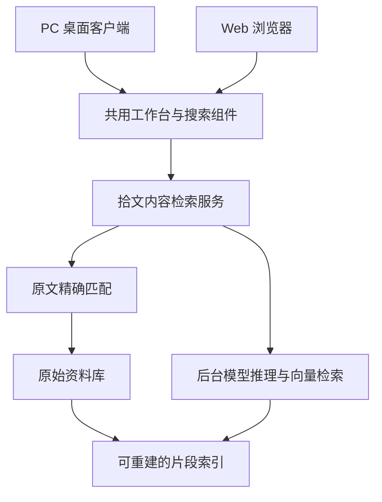

# 拾文 PC 客户端与 Web 共用搜索实施方案

日期：2026-11-17。范围：PC 桌面客户端与 Web。状态：PC 搜索已实施，Linux 包已完成隔离验收。

本次解决的核心问题是：写作时隐约记得过去表达过某个想法，却因为记不得原词、日期或标题，无法从日记、自由书写等记录中找回来。用户应当能描述想找的内容，看到相关原文段落，核对上下文，再用于当前写作。

确定采用一套共用的内容检索服务，提供“按原文”和“按意思”两种方式。第一版采用本地轻量中文向量模型，保留精确匹配，集中完成 PC 两个入口；Android 暂不推进。

**一 产品范围**

| 内容入口 | 本期接入方式 | 保留的范围与筛选 |
| --- | --- | --- |
| 素材列表 | 搜索标题、正文和读书摘录；按意思返回相关片段 | 素材类型，包含日记、自由书写、想法、网页、参考资料、已保存的 AI 讨论 |
| 文章列表 | 搜索文章标题与正文 | 文章阶段 |
| 读书笔记 | 搜索原文摘录和个人感想，结果区分两者 | 本书或全部书、章节、笔记类型、日期 |
| 写作素材栏 | 搜索可关联素材，展示命中片段，展开原文后加入本篇或插入引用 | 资料库或本篇素材、素材类型、书籍 |

“各个内容搜索入口”指上述拾文记录入口。书名选择器、日期筛选、设置项查找、页面内查找保留精确定位的含义。未保存为拾文记录的 DSH 聊天历史，以及单独的 AI 批注搜索，不在本期新增范围内。

已有 Agent、MCP 搜索调用继续保持默认精确匹配和现有返回契约；共用服务预留明确的语义模式参数，后续可复用，第一版不同时扩展外部工具协议。

**二 PC 两端的共用架构**

桌面客户端现有 Electron 外壳连接拾文服务并加载工作台页面；Web 也使用工作台与资料库插件。窗口、托盘、连接设置和打包仍属于桌面外壳，内容检索放进共同的服务层。

同一个服务实例只加载一份模型、维护各资料库自己的索引。浏览器和 Electron 渲染页面不各自下载模型。连接远端拾文服务时，模型和索引运行在该服务所在机器，界面明确展示服务位置；“本地推理”不表示远端访问时数据仍只在浏览器设备上。

共用代码不自动合并资料库。不同服务或 profile 的资料库保持隔离；连接同一服务的 PC 客户端与 Web 才会使用同一份资料和索引。

**三 搜索交互**

每个内容入口使用一致的模式切换，文案为“按原文”和“按意思”。原文搜索保留现有的关键词或整句包含匹配行为，不要求用户使用正则表达式。初始默认按原文，用户切换后的选择按资料库与入口记忆。

按意思支持自然语言，例如：“找找我以前关于行动、开始做事的想法”“写提案想用，从反复琢磨到真正动手的体会”。提示用户描述意图，但不要求先选择标签或重新整理旧记录。

输入为空时沿用原有列表与排序。进入语义查询后，先在当前范围内筛选，再按相关性排序；读书笔记的语义结果按相关性呈现，不让章节分组打散排名。切回浏览或原文模式时恢复原有浏览方式。

结果包含标题、记录类型、日期、相关原文片段及来源字段。读书摘录还显示书名、章节、页码；个人感想与摘录分开展示。正文结果按记录去重，读书卡片按既有卡片粒度去重，避免一篇长记录占满结果。

点击结果打开原记录并定位对应片段，保留前后文；返回列表时保留查询、筛选、滚动位置。写作素材栏沿用现有“加入本篇”和“插入引用”，用户可以选取命中段落或上下文中的其他原文。旧版多摘录读书笔记需带上摘录序号，不能误开或误引用同一记录中的另一条摘录。

语义结果统一标识为“相关内容”，不把相似分数显示成正确概率，也不生成“你之前就是这样说过”的结论。资料里没有那段具体经历时，允许用户看到相关材料，但不得把它表述为精确找回。第一版不根据小型测试集拍定一个通用拒绝匹配阈值。

查询采用短延迟防抖，中文输入法组词期间不发起搜索。新查询或范围变化后取消、忽略旧请求；加载新结果期间不把上一条查询的结果误当成当前结果。显示结果范围、加载状态、错误及重试入口，提供分页或加载更多。

**四 模型与检索方式**

第一版采用已验证的 `BAAI/bge-small-zh-v1.5`，固定模型修订、分词器、查询指令、池化与归一化方式。当前试验下载文件约 92 MiB（约 96 MB）；这是文件占用，不是运行内存，也不是最终客户端增加的体积。

正式产品使用 Node 服务中的 ONNX Runtime CPU 推理，放在后台工作线程或独立工作进程中，避免阻塞界面和资料库请求。用户不需要安装 Python、启动模型服务或配置模型 API Key。现有 Python 环境仅用于评测和模型转换校验，不作为交付依赖。ONNX Runtime 提供 Windows 与 Linux 的 Node CPU 绑定，实际依赖版本与打包产物必须在实现时固定并验证。

先转换、校验未量化模型，保持与本轮评测一致的语义能力。量化、GPU 加速和其他模型作为后续优化，本期不同时引入。模型转换后的输入分词、向量维度、归一化及排序需要与原始模型对照，不能只以“能够加载”判定通过。

两种检索各自保持清晰行为：按原文执行精确匹配；按意思执行向量相似度排序。第一版不采用等权 BM25 融合，也不加载约 1 GB 的通用重排模型。本期不依赖 Jev，不直接接入整套 SAG-Wiki，不调用远程模型处理私人记录。

**五 模型安装与状态**

首次使用按意思搜索时，界面提供“启用语义搜索”，说明下载大小、执行服务位置，以及完成准备后可离线使用。启用后由服务统一下载，显示下载与建库进度；多个窗口同时启用应复用同一个任务。

下载固定版本的模型文件并校验完整性，先写临时文件，校验成功后原子替换。中断、网络失败或磁盘不足保留明确的失败状态和重试能力，不把半成品当成可用模型。模型文件存入持久的服务数据目录，不能依赖 `/tmp` 中的试验文件。

状态至少包括：未启用、下载中、建立索引中、可搜索、正在更新、失败。模型下载或索引未就绪时，原文搜索始终可用；不得悄悄把“按意思”降级为关键词搜索后仍标成语义结果。

首次索引完成后使用按意思搜索。后续有增量更新时可搜索仍有效的已索引内容，并提示更新中；有变化但尚未索引的记录暂不作为旧内容返回，完成后提示刷新结果。状态与重试、重建索引入口由 PC 两端共用。

**六 数据模型与索引**

原始日记、自由书写、文章等继续以完整记录保存。新增的是可重建的派生索引，不要求用户把历史记录拆成卡片，不改变原记录的类型、来源或正文。

索引保存三个层次的信息：

| 层次 | 必要信息 | 用途 |
| --- | --- | --- |
| 记录快照 | 资料库标识、记录 ID、版本、内容哈希及可查询元数据 | 隔离资料库、筛选范围、判断是否失效 |
| 内容片段 | 片段 ID、字段、原文范围、原文或重建所需锚点，读书摘录序号 | 展示命中片段、回到原文、避免混淆摘录与感想 |
| 向量与索引版本 | 向量、模型修订、分词器版本、切分规则版本 | 复用计算、模型升级时正确重建 |

正文优先按自然段和句子边界切分。过长段落按实际模型 token 上限继续分段，保留适量重叠及标题上下文；不得只对全文开头做截断，也不能切断 Unicode 字符。读书摘录、感想分别建立片段，章节与页码作为元数据保留。清理用于检索的 Markdown 标记时必须保留到原文的映射，不能用清理后的位置直接定位原文。

搜索响应包含原文版本和锚点。打开结果或引用前若原文已变化，应重新读取并刷新定位；不能把旧偏移应用到新正文。现有文章与素材记录的关联继续使用，第一版不另做一套引用关系系统。

派生索引放在资料库自己的搜索目录中，与主业务数据库分开；可以删除、重建，不能作为原始数据的唯一副本。第一版采用本地向量存储与有界扫描，先以一万片段的测试库验证；不引入独立向量数据库或图数据库服务。

**七 更新与一致性**

新增、编辑、追加日记、读书笔记保存、导入、同步接收、删除与恢复，都必须使对应索引失效或进入更新队列。先完成原始资料保存，再异步更新索引；模型失败不得使记录保存失败。

同一记录连续编辑时合并待处理任务。计算结果写入前核对记录最新版本，丢弃已过期结果；更新片段与向量时使用事务。进程重启后核对索引清单与当前记录，补上未完成任务。模型、分词器或切分版本改变时重建对应索引。

删除后立即排除该记录，包含仍在内存或旧索引中的片段；恢复后重新纳入。返回搜索结果前，再核对删除状态、当前版本、资料库与查询范围。旧查询缓存不得让已删除或已更新的内容重新出现。

增量队列控制批次与并发，前台查询优先于批量建库；长任务可中断并恢复。服务退出时释放工作进程、模型与数据库资源。索引不加入 Android 同步协议，也不要求所有客户端升级后才能使用本功能。

**八 代码接入边界**

| 位置 | 计划职责 |
| --- | --- |
| `plugins/library` | 共用检索服务、片段构建、模型适配、派生索引与更新任务 |
| `plugins/workbench/src/index.mjs` | 增加内容搜索与搜索状态接口，沿用现有授权边界 |
| `plugins/workbench/src/client.jsx` 与列表组件 | 素材、文章入口使用共用查询控制与结果展示 |
| `plugins/workbench/src/WritingSources.jsx` | 按范围查素材，展示与引用相关原文 |
| `plugins/workbench/src/reading` 的 PC 适配入口 | 接入读书卡片搜索、书籍与章节筛选、结果定位 |
| 服务准备与打包脚本 | 包含推理运行时、工作进程及模型下载清单，支持独立 Web 启动与桌面打包 |

查询接口统一接收搜索文字、模式、内容范围、类型、日期、文章阶段、书籍与章节、本篇素材范围和分页信息；服务端校验参数并在排序前应用过滤。返回结果、匹配片段、索引状态与分页信息，避免各个界面重新实现完整检索逻辑。

读取内容的授权范围沿用现有资料库规则，模型启用、重建等管理操作走已有的所有者会话权限。前端传入的记录 ID 或筛选不能扩大服务允许访问的范围。

Android 目录、原生检索、安装包和设备均不改动。部分读书界面存在共用代码时，通过 PC 适配器提供可选搜索能力，默认行为保持兼容，不把新的模型请求或控件强制注入 Android。现有未提交改动不属于本次实施，不顺手整理或覆盖。

**九 实施顺序与交付**

1. **共用服务与真实模型。** 完成正式推理运行时、模型下载与状态、片段索引、原文和语义查询、增量更新。在隔离资料库中验证真实模型，保证 Web 与桌面服务能够调用同一个实现。
2. **统一接入四个入口。** 先完成素材和文章列表的共用组件，再接读书笔记与写作素材栏；交付时四个入口全部具备两种模式，保留原有筛选、编辑和引用操作。
3. **验证并交付 PC。** 验证独立 Web 服务与桌面客户端两条启动路径、首次模型准备、离线复用、更新删除、打包后的真实模型推理；记录版本、性能和未覆盖平台。

本次方案文档本身不触发打包或发布。进入包交付阶段时遵循仓库约定：提升版本、使用统一产物脚本，调试包放 `debug/<平台>/`、正式包放 `release/<平台>/`，新包通过校验后再替换旧包。不自动发布 GitHub Release，不修改 Android 版本。

**十 验收标准**

| 验收项 | 通过条件 |
| --- | --- |
| 精确搜索兼容 | 原标题、关键词、整句查询继续有效；空查询仍为浏览；无模型也能使用 |
| 真实语义能力 | 能从日记与自由书写找回没有原词的相关段落；使用真实模型执行，不用预置答案替代推理 |
| 四个入口 | 素材、文章、读书笔记、写作素材栏均可切换模式；各自范围在服务端正确生效 |
| 原文可核对 | 点击命中能看到正确段落和上下文，摘录与感想不串位；原文变化后不会使用过期定位 |
| 内容一致性 | 新增、修改、追加、导入、同步、删除、恢复与重启后均符合索引规则；删除记录立即不再返回 |
| 两端共用 | 浏览器与桌面连接同一服务时，查询范围和结果一致，模型不会重复下载或加载 |
| 错误与竞态 | 下载失败、离线首次启用、工作进程失败、输入法组词、连续查询与切换范围均有可理解行为 |
| 性能 | 在明确记录硬件的一万片段隔离库上，以模型已加载的查询 p95 不超过 500 ms 为工程目标；同时记录冷启动、索引耗时、峰值内存和包体增量。该目标不是现有实测结论 |
| 正式推理一致性 | ONNX 与评测模型的分词和向量符合约定，固定查询的前列结果无实质退化；不能只验证模拟接口 |
| 平台与回归 | Web 浏览器和实际桌面进程分别验收；保存、草稿、读书卡片、引用操作通过相关回归；Android 行为不因共用组件变化而改变 |

现有 30 篇、90 段、10 查询的固定虚构语料用作回归，不用于宣布普遍的检索准确率。上线体验还应补充独立标注、用户认可的真实或脱敏样本，覆盖模糊记忆、反向观点、长记录、同词干扰和不存在的具体经历。判定标准是结果是否能帮助写作，不能只统计有没有返回内容。

**十一 已有证据与明确延后事项**

本轮本机 CPU 小样本中，向量检索的展示片段 nDCG@5 约为 0.591，查询预热中位耗时约 6.8 ms；中文分词 BM25 约为 0.392，等权融合约为 0.523，追加通用重排约为 0.399，重排完整链路中位约 1.47 秒。该结果支持先实现轻量语义检索，不代表模型在真实资料库或大规模数据下已经验收。两个没有对应具体经历的查询仍返回相似材料，因此结果文案与原文核对不可省略。

延后 Android 端侧模型、云端向量接口、Jev 或 SAG-Wiki 集成、重排模型、知识图谱、自动标签、反向引用面板、保存筛选视图以及未归档聊天历史的统一检索。以上功能不会作为完成本期搜索的前置条件。

参考：[固定测试与逐条结果](../../../reports/shiwen-retrieval-evaluation/index.html)、[测试汇总](../../../reports/shiwen-retrieval-evaluation/summary.csv)、[BGE 模型说明](https://huggingface.co/BAAI/bge-small-zh-v1.5)、[ONNX Runtime Node 支持](https://onnxruntime.ai/docs/get-started/with-javascript/node.html)。

**实施记录（2026-11-17）**：PC 四入口及共用服务已实现，Linux 0.1.26 安装包已构建并做隔离验收；模型、性能、回归与平台限制见 [验收记录](./pc-semantic-search-qa.md) 和 [验收矩阵](./pc-semantic-search-acceptance.md)。Windows 未构建或实机验证。
